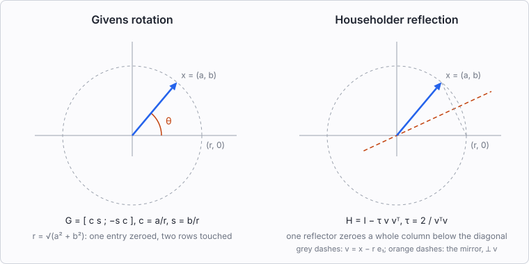

# Givens and Householder in pictures

Four animations show what a Givens rotation and a Householder reflector do,
how each one builds a QR factorization, how rotations drive the QR iteration
for singular values, and what happens to orthogonality when a rotation is
computed in a narrow number format. The history and references behind them
are in [givens-householder-history.md](givens-householder-history.md). This
page is part of the series in #666.

The figures are generated by `tools/givens_householder_svg.py`, which uses
only the Python standard library:

```bash
python3 tools/givens_householder_svg.py          # writes docs/img/gh-*.svg
```

The animations are SVG's own SMIL elements, with no script, so they play in
any browser, including through an `` tag. Rerunning the script
reproduces the committed files byte for byte.

## 1. Two ways to put a vector on an axis



Both operators take $x = (a, b)$ to $(r, 0)$ with $r = \lVert x \rVert$, and
both are orthogonal, so neither changes a length.

- **The rotation** turns $x$ through its own angle $\theta$. Its matrix
  $G = \begin{bmatrix} c & s \\ -s & c \end{bmatrix}$ needs only
  $c = a/r$ and $s = b/r$; the angle itself is never computed. $\det G = +1$.
- **The reflection** flips $x$ across a mirror. The mirror is the line
  perpendicular to $v = x - r e_1$, which bisects the angle between $x$ and
  the axis. $H = I - \tau v v^T$ with $\tau = 2 / v^Tv$, and $\det H = -1$.
  For $a > 0$, computing $a - r$ directly cancels when $b$ is small, so the
  first component is computed as $v_1 = -b^2 / (a + r)$ (Parlett's form). If
  $b = 0$ and $a > 0$, $x$ is already on the axis, $v = 0$, and the identity
  is used in place of a reflector.

In two dimensions the two do the same job. The difference shows in $n$
dimensions. A rotation acts on two coordinates and zeroes one of them. A
reflector acts on all of them and zeroes every coordinate but the first in a
single step. That difference decides which one each algorithm below uses.

The figure reflects onto $+r e_1$, the sign MTL5's `householder()` uses for
a vector with $a > 0$ (Parlett's form). LAPACK's `dlarfg` reflects the same
vector onto $-r e_1$, across the other bisector. Both choices avoid
cancellation; [householder-reflector-forms.md](../numerical/householder-reflector-forms.md)
compares them.

## 2. QR one entry at a time, or one column at a time



The same $7 \times 4$ sparse matrix is triangularized twice. On the left,
each rotation turns one row below the diagonal into the pivot row and zeroes
one entry. On the right, each reflector zeroes a whole column below the
diagonal. The yellow band marks the rows each step touches. Orange cells are
fill: entries that were zero in $A$ and become nonzero.

| | Givens | Householder |
|---|---|---|
| steps | 18 rotations | 4 reflectors |
| operations (sparse-aware count) | 282 | 218 |
| fill created | 15 | 15 |
| peak entries stored | 21 | 28 |

The counts come from the script's symbolic run. They count multiplies and
adds on the nonzero columns of the rows a step touches. They are not timings.

What the figure shows:

- **The final $R$ is the same.** With no lucky cancellation, the pattern of
  $R$ is that of the Cholesky factor of $A^TA$, whichever orthogonal
  transformations produce it. Both methods create the same 15 fill entries.
- **Householder does less arithmetic.** The first reflector reads the whole
  first column at once. For a dense $m \times n$ matrix the counts are about
  $2n^2(m - n/3)$ flops for Householder and $3n^2(m - n/3)$ for Givens. This
  is why dense QR (LAPACK's `dgeqrf`, and MTL5's `qr_factor`) and the
  least-squares solves built on it use reflectors.
- **Givens touches less at a time.** The first reflector fills every row it
  touches before later reflectors clear them, so the stored count peaks at
  28. The rotations touch two rows per step and peak at 21. When rows arrive
  one at a time, or a factorization is updated after a row is added or
  removed, rotations are the natural tool: the new row is rotated into the
  existing $R$ and nothing else changes.

Rotations also win when the matrix is already nearly triangular. An upper
Hessenberg matrix needs one rotation per column, on two rows. That is the
least-squares problem inside GMRES, which MTL5 solves with
`apply_givens_rotation` in `include/mtl/operation/givens.hpp`.

## 3. Chasing the bulge



The QR algorithm for eigenvalues and singular values first reduces the matrix
to a band: Hessenberg, tridiagonal or bidiagonal. It then repeats a step that
keeps the band but makes its off-diagonal entries shrink. The figure shows
one Golub–Kahan step on an upper bidiagonal matrix $B$:

1. A right rotation on columns 1 and 2 brings in the shift. It creates one
   nonzero below the band, the bulge.
2. A left rotation on rows 1 and 2 zeroes the bulge and creates a new one
   above the band.
3. The rotations alternate, each one zeroing the previous bulge and creating
   the next one a place further down, until the bulge falls off the corner.

An $n \times n$ step costs $2(n - 1)$ rotations and $O(n)$ work, against
$O(n^3)$ for the reduction that came before. Rotations suit this because each
one has to remove exactly one entry without disturbing the band.

- **Symmetric tridiagonal eigenvalues** use the same chase with one rotation
  per position. MTL5's `eigenvalue_symmetric` does this
  (`include/mtl/operation/eigenvalue_symmetric.hpp`).
- **Nonsymmetric eigenvalues** use the Francis double-shift step on a
  Hessenberg matrix. Its bulge is $3 \times 3$, so the chase uses small
  $3 \times 3$ reflectors (`include/mtl/detail/francis_qr.hpp`).
- **Singular values in LAPACK** (`dbdsqr`) use the step in the figure. MTL5's
  `svd` takes a different route, one-sided Jacobi
  (`include/mtl/operation/svd.hpp`). It applies plane rotations to pairs of
  columns until they are orthogonal, which is Jacobi's 1846 method applied
  to columns.

## 4. Orthogonality in a narrow format



Forty-eight points on the unit circle are rotated 400 times by the same
rotation through one radian, with every multiply and add rounded to the
format. After each multiple of 8 rotations, the points are rotated back
exactly by $-k\theta$, so only the error remains: an exact rotation would
leave the dashed circle where it is. The chart plots the largest radius
error, $\max \lvert\, \lVert G^k x \rVert - 1 \rvert$.

| format | $c^2 + s^2 - 1$ | error at $k = 0$ | $k = 96$ | $k = 400$ |
|---|---|---|---|---|
| fp8 E4M3 (OCP, saturating) | $-2.3 \times 10^{-2}$ | $3.0 \times 10^{-2}$ | $0.25$ | $0.23$ |
| bfloat16 | $-4.1 \times 10^{-3}$ | $1.8 \times 10^{-3}$ | $0.21$ | $0.61$ |
| binary16 | $-3.0 \times 10^{-5}$ | $2.4 \times 10^{-4}$ | $4.8 \times 10^{-3}$ | $9.1 \times 10^{-3}$ |
| posit<16,2> | $1.2 \times 10^{-4}$ | $1.1 \times 10^{-4}$ | $8.5 \times 10^{-3}$ | $2.6 \times 10^{-2}$ |

Two effects are at work.

- **The rounded rotation is not orthogonal.** Once $c$ and $s$ are rounded,
  $c^2 + s^2 \ne 1$, and every application scales the plane by
  $\sqrt{c^2 + s^2}$. Applied $k$ times, that is a geometric drift of about
  $k (c^2 + s^2 - 1)/2$. bfloat16's circle shrinks steadily for this reason,
  so its radius error in the chart keeps growing.
- **Every operation rounds.** Each multiply and add adds an error of order
  the unit roundoff. These errors do not share a sign, so they accumulate
  more slowly, like a random walk. They are what makes the binary16 and
  posit curves wiggle.

The fp8 points snap to a coarse grid within a few rotations. Its error then
stays near 0.25: the format has three fraction bits, and a point on the unit
circle cannot move by less than a grid step.

At sixteen bits the ranking depends on the angle. posit<16,2> has 11 fraction
bits on $[1/4, 1)$, where $c$ and $s$ lie, against binary16's 10. For one
radian, though, the rounding of $c$ and $s$ happens to leave posit<16,2> with
a larger $c^2 + s^2 - 1$, and that bias dominates by $k = 400$. At other
angles the two swap places, or round to the same $c$ and $s$. One extra bit
of precision does not guarantee a smaller error in this test.

This is a deliberately harsh test: one rounded rotation applied 400 times,
so its bias compounds. A factorization computes a fresh rotation or
reflector for every step, from the data in front of it, and the backward
error bounds of Higham's chapter 19 grow only linearly in the number of
transformations. Some algorithms do accumulate a long product of
transformations explicitly, though: the $Q$ of an eigensolver, or the $V$ of
one-sided Jacobi. In a narrow format that product is where to look, by
measuring $\lVert Q^TQ - I \rVert$. A square-root Kalman filter instead
triangularizes afresh at every step and carries only the triangular factor;
how that factor holds up over many steps is a separate question. The
mp-numerics studies #13 to #15 make these measurements across formats.
