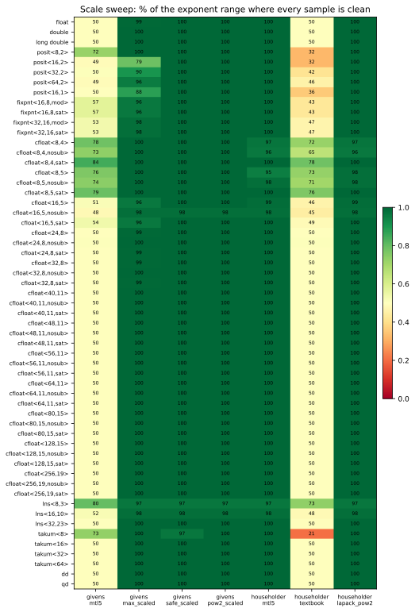
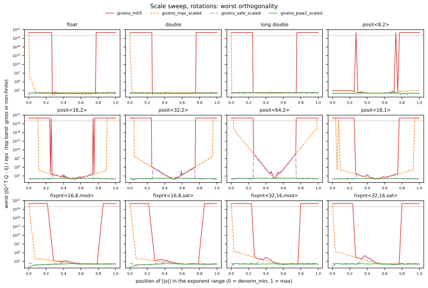
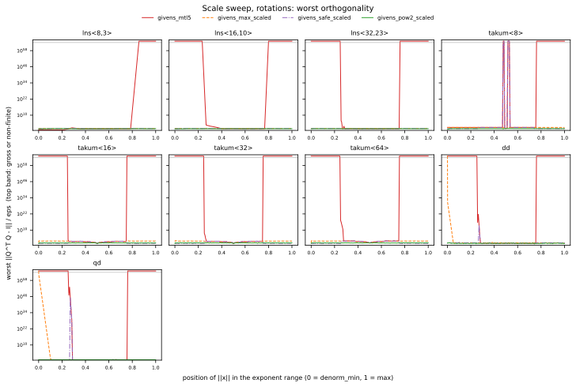
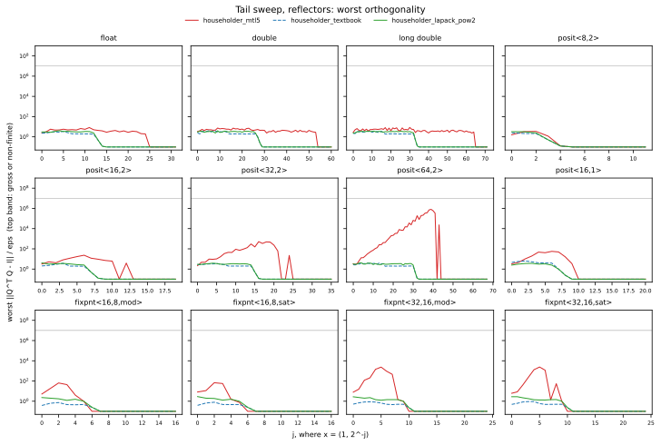

# Givens and Householder across number systems

MTL5's rotations and reflectors are generic over the scalar type, so they run
unchanged on posits, fixed point, logarithmic numbers and wide floats. This
page reports what one rotation or one reflector does in 65 number types,
measured exactly. These are the results of the first study of the series in
mtl5#666, mp-numerics#13.
[The history](givens-householder-history.md) explains why these operators are
built the way they are, and [the pictures](givens-householder-pictures.md) and
[the explorer](../site/algorithms/givens-householder-explorer.mdx) show them in small formats.

The short version:

- **MTL5's Householder reflector is clean over essentially the whole range of
  every type.** The rotation used by GMRES, MINRES and the symmetric QR
  iteration is clean over only about half of it.
- **Scaling by an exact power of two is the one form clean and accurate in all
  65 types.** The rotation scaled this way is clean everywhere. The reflector
  is too, apart from a few overflows in the top binade of the 8- and 16-bit
  IEEE cfloats. LAPACK's scalings
  prevent overflow, but in a tapered type or in double-double they don't keep
  the precision.
- **MTL5's choice of sign costs accuracy in posits, takums and fixed point.**
  In IEEE it doesn't.

## What was measured

Each operator is built for a vector x = (a, b) in the type, and its values are
read out as exact Shewchuk expansions. So every number below is the error of the
operator the arithmetic produced, not of a double approximation to it. The
exception is lns: its values are not dyadic, so they are read through double.
That is still far finer than lns<32,23>'s own resolution.

The main measure is ‖QᵀQ − I‖₂, reported in units of the type's `epsilon()`. A
sample is **gross** when ‖QᵀQ − I‖₂ itself, or the part of x the operator
failed to annihilate relative to ‖x‖, is above max(1/2, 16 eps). Neither
measure is divided by eps for this test. It is **non-finite** when an infinity or NaN appears.
A sample is **clean** when it is neither.

| operator | what it is |
|---|---|
| `givens_mtl5` | `mtl::apply_givens_rotation`: r = sqrt(a·a + b·b), c = a/r, s = b/r. MINRES and the symmetric QR iteration use the same formula |
| `givens_max_scaled` | divide by max(\|a\|, \|b\|) first, as LAPACK's `lapy2` does |
| `givens_safe_scaled` | Anderson's safe scaling, from Reference-LAPACK `dlartg.f90` |
| `givens_pow2_scaled` | scale by an exact 2^-e with 2^e ≤ max(\|a\|, \|b\|) |
| `householder_mtl5` | `mtl::householder`: max-scaled, Parlett's sign (onto +‖x‖e₁ for x₀ > 0), v(0) = 1 |
| `householder_textbook` | `mtl::householder(x, tag::textbook_reflector)`: unscaled, LAPACK's sign |
| `householder_lapack_pow2` | `dlarfg`'s sign (onto −sign(x₀)‖x‖e₁), v(0) = 1, on x scaled by an exact 2^-e |

`givens_mtl5` and `householder_mtl5` are MTL5 5.21.0, which the study measured.
MTL5 5.22.0 adopted the two remedies: `apply_givens_rotation`, MINRES and the
symmetric QR iteration scale by an exact power of two, as `givens_pow2_scaled`
does (#671), and `householder` takes `dlarfg`'s sign on x scaled by an exact
power of two, as `householder_lapack_pow2` does (#672).

The inputs are random directions with ‖x‖ = 2^k for k across each type's
whole exponent range (the **scale sweep**), and x = (±1, ±2^-j (1 + u)) with u uniform in
[0, 1), for j from 0 to past the type's precision (the **tail sweep**). A third sweep applies operators
repeatedly.

The types are:
- float, double and x87 long double;
- posit<8,2>, <16,1>, <16,2>, <32,2> and <64,2>;
- fixpnt<16,8> and <32,16>, wrapping and saturating;
- cfloat from FP8 (E4M3, E5M2) to 256 bits, each with IEEE behaviour, without
  subnormals, and saturating;
- lns<8,3>, <16,10> and <32,23>;
- takum<8> to <64>;
- Universal's dd and qd.

cfloat<32,8> and <64,11> reproduce float's and double's measurements bit for
bit, so the cfloat rows can be read as IEEE rows.

## Where each operator is clean

Two columns stand out:
- **MTL5's rotation** is clean on half of each range. a·a overflows once |a|
  passes sqrt(max), and underflows below sqrt(min): in double the clean band is
  k ∈ [−533, 509] of [−1074, 1023].
- **The textbook reflector**, also unscaled, has the same limit.

The scaled forms are clean over all or nearly all of every range, with two
kinds of exception:
- `lapy2`'s max-scaling turns gross at the ends of the wider posits' ranges.
  It is clean on 79 to 96% of them.
- Elsewhere, a cell below 100 marks either the bottom of a range, where every
  input flushes to zero, or a few overflows in the top binade of the 8- and
  16-bit IEEE cfloats.

Clean is not the same as accurate, though. The next figure shows the error
inside the clean region.

## Rotations: scaling against overflow is not scaling for precision

The top band of each panel marks gross or non-finite samples. MTL5's rotation
(red) fails at both ends in IEEE. In a posit or a saturating fixed-point type
the square saturates instead, and the rotation is finite and wrong.

The two LAPACK scalings stop the overflow, but each loses precision somewhere:

- **`lapy2`'s max-scaling** (orange) computes c = a/r, so the error of r at the
  input's own magnitude goes into c. That magnitude is subnormal in IEEE, or far
  from 1 in a posit, where r has few bits. The orthogonality error reaches
  1.1×10¹⁵ eps in double near the subnormal range, and 1.4×10¹⁷ eps in
  posit<64,2>.
- **`dlartg`'s safe scaling** (purple) is what it was designed to be in IEEE:
  within 2.1 eps over the whole range, in every cfloat from 8 to 256 bits as
  well. In a posit it never fails grossly. But its thresholds come from where
  the type overflows (sqrt(min) and sqrt(max/2)), and inside them a posit's
  squares fall where it has few bits: 5×10⁸ eps in posit<64,2>.
- **Power-of-two scaling** (green) rounds nothing in a floating-point type and
  puts the squares near 1. It stays within 2.2 eps in every type except dd and
  takum, where it stays within 4.6 eps.

The types added in the second part of the study show the same thing:

- **Takums** behave like posits, but far more gently: `dlartg` reaches 50 to 95
  eps, against posit<64,2>'s 5×10⁸.
- **dd and qd** have full precision only above 2^-969, where the low limb
  still fits, but `numeric_limits` reports double's range. So `dlartg`'s
  thresholds let squares into the degraded zone: 6.5×10¹³ eps in dd and
  1.4×10⁴⁵ in qd, both about 2^-59 in absolute terms.
- **Formats without gradual underflow** (lns, and cfloat without subnormals)
  make the unscaled rotation inaccurate before it fails. A small square flushes
  or rounds up instead of losing bits gradually: MTL5's rotation reaches
  6.6×10¹³ eps in cfloat<64,11,nosub>, against 1.2 eps with subnormals, and
  5.7×10⁵ eps in lns<32,23>.
- **The subnormals are also what costs `lapy2` its accuracy.** In every cfloat
  without them, the max-scaled rotation stays within 2.7 eps over the whole
  range.

## Reflectors: the sign matters off IEEE

On the tail sweep |x₀| = 1. From j = 1 on, |x₁| < 1, so MTL5's max-scaling
divides by 1 and rounds nothing, and the sign is the only difference between
MTL5's reflector (red) and the LAPACK-sign form (green). At j = 0, |x₁| can
exceed 1, and the scaling rounds too.

Parlett's sign makes v₀ = −σ/(x₀ + ‖x‖) small for a small tail. After
normalizing to v(0) = 1, v₁ ≈ −2x₀/x₁ is then large:
- In IEEE that costs nothing: about 9 eps at worst.
- In a posit, v₁ and 1 + v₁² land where the posit has few bits: 512 eps in
  posit<32,2> and 8×10⁵ in posit<64,2>, and 207 eps in takum<64>.
- In fixed point, which has absolute rather than relative precision, it reaches
  2.4×10³ eps in fixpnt<32,16>.

MTL5's identity fallback (5.21.0) catches the worst of it only once the error
exceeds the tail, from j = 40 in posit<64,2>.

With `dlarfg`'s sign, |v₀| ≥ ‖x‖, so every entry of the normalized v is at
most 1, and `householder_lapack_pow2` stays within 8.7 eps in every type, at
every scale and every tail. Its only failures are a few overflows in the top
binade of the 8- and 16-bit IEEE cfloats.

The textbook form has the LAPACK sign too, and on the tail sweep it is within
6.4 eps in IEEE, posits and fixed point. It is unscaled, though, so it shares
the unscaled rotation's half-range limit.

## Repeated application

One rounded rotation applied k times stretches or shrinks a vector by about
k·|c² + s² − 1|/2. At k = 4096 that is 880 to 3.4×10⁴ eps in every type of
16 bits or more, however the rotation was computed. The exception is qd, at 22
to 109 eps, which holds more bits than its eps counts. Accumulating k fresh
operators into an 8 × 8 Q grows far more slowly: 30 to 540 eps at k = 1024 in
every type of 16 bits or more.

Saturation hides the overflow. In IEEE FP8, some of the repeated-rotation trials
end at infinity. In the saturating variants the same trials end clamped at the
largest value, with a deviation of 2.3×10³ eps in E4M3, 2.7×10⁵ in E5M2, and
3.9×10⁶ eps for MTL5's reflector in cfloat<16,5,sat>. The result is wrong, and
nothing in the value says so.

## What this means for MTL5

For double and float nothing here is urgent. The unscaled rotation fails only
for inputs outside about 2^-533 to 2^509 in double (10^-160 to 10^153), or
2^-74 to 2^63 in float. The reflector is accurate over the whole range.

For other scalar types:

- **The Householder path (`qr_factor`) is the safer one** when the data's
  magnitude is not known to sit near 1. It is clean across every type's range,
  though in posits, takums and fixed point its sign costs accuracy on small
  tails (above).
- **Expect rotation-based solvers to fail toward the ends of the range.**
  MINRES, GMRES's Hessenberg QR and the symmetric tridiagonal QR iteration use
  the unscaled rotation. It loses about half the exponent range in nearly every
  type tested. In posit<64,2> and takum<64> it also loses most of the precision
  inside that band: 5×10⁸ and 1.9×10¹⁷ eps.
- **Don't trust thresholds taken from `std::numeric_limits` in a tapered type
  or in dd.** They describe where a type overflows, not where it is precise.

The study suggests two changes. Neither is made yet:

- Scale `apply_givens_rotation`, and the same formula in MINRES and the
  symmetric QR iteration, by an exact power of two before squaring. In IEEE
  this costs two exponent extractions and removes the half-range limit. In the
  other types it also keeps the accuracy.
- Reflect onto −sign(x₀)‖x‖e₁, as `dlarfg` does. This changes the sign of R's
  diagonal, which MTL5 currently keeps non-negative for x₀ > 0. See
  [Householder reflector forms](../numerical/householder-reflector-forms.md)
  for what callers pinned to a sign depend on.

## Universal behaviour met along the way

The study worked around these, and they are filed in Universal:

- **[universal#1881](https://github.com/stillwater-sc/universal/issues/1881).**
  The Dekker `split` rounds the high half of a double near `DBL_MAX` up to
  2^1024, so `dd(DBL_MAX) * dd(0x1p-512)` is a NaN. The same split makes dd and
  qd multiplication and division, and dd_cascade's division, return NaN at the
  top of the range.
- **[universal#1882](https://github.com/stillwater-sc/universal/issues/1882).**
  - `numeric_limits<dd>::max()` is not a normalized pair: it converts to an
    infinity, and `max() * 1` is NaN.
  - dd's `min()` (2^-969) disagrees with its `min_exponent` (double's −1021).
  - dd_cascade's `min()` is `denorm_min()`.
- **[universal#1883](https://github.com/stillwater-sc/universal/issues/1883).**
  dd's `sqrt` is off by up to 7.9 units of 2^-106, where dd_cascade's is
  within 0.75.

## Reproducing

The harness, the CSVs with their `.sysinfo` sidecars, all twelve figures and
the full tables are in
[mp-numerics/benchmarks/linalg/givens_householder](https://github.com/stillwater-sc/mp-numerics/tree/382bcea48dc405a1113171cdb121bcbe0107d296/benchmarks/linalg/givens_householder).
The figures on this page are copied unchanged from that commit. The full run
takes about four minutes, and its CSVs are byte-identical between GCC 15 and
Clang 21 on x86-64.
