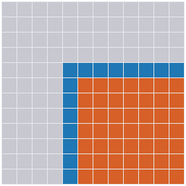
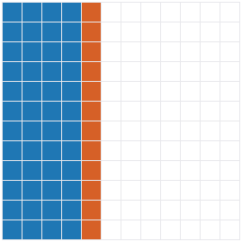

# The Accuracy Architecture

MTL5 separates three precisions that most linear algebra libraries fuse into one:
- the precision data is **stored** in;
- the precision each reduction is **accumulated** in;
- the precision a result is **delivered** in.

A quire or super-accumulator can then hold a whole dot product and round it once. Whether it can do that for a given algorithm depends on the algorithm's **loop order**, not on its number types. This document explains how that works, and what it requires of an algorithm before a better accumulator can improve its result. It also covers what happens when a reduction is split across threads or processes.

The measurements behind it are in [Accumulation Configurations](../algorithms/accumulation-configurations.md). This page explains them; it does not repeat their tables.

## 1. The three precisions and the accumulator protocol

### Input, accumulation, output

| precision | what it is | in MTL5 |
|---|---|---|
| input | what is stored | the element type `T` of the matrices and vectors |
| accumulation | where each reduction lives while it is formed | the `Accumulator` template argument, `Acc` |
| output | what a reduction is rounded to when it leaves the accumulator | `accumulator_value(acc, std::type_identity<R>{})`, the optional `Result` argument |

**One working precision.** The usual model has one working precision: every product and every partial sum is rounded to `T`.

**Mixed-precision iterative refinement** has three precisions too, but different ones:
- a factor precision, in which the matrix is factored;
- a working precision, in which the solution is stored;
- a residual precision, in which `b − A·x` is formed.

Those are precisions of *data*. The accumulation precision is a precision of *reductions*, and it applies inside every one of those steps. MTL5 composes the two: `supernodal_lu_solve_refined<float, Acc>` factors in float, refines in double, and accumulates the factor's reductions in `Acc` ([Accumulation Configurations](../algorithms/accumulation-configurations.md#direct-solvers-and-refinement)).

[Mixed-Precision Kernels](../algorithms/mixed-precision-kernels.md) covers the element → accumulate → result model for the SIMD kernels.

### The protocol

`include/mtl/math/accumulator_traits.hpp` defines what an accumulator does: `clear`, `assign` (start from a value), `add_product(acc, a, b)`, `value<R>` (round out) and an optional `merge`.

| | configuration | type | what it rounds |
|---|---|---|---|
| 1 | plain | `Acc = T`, or a wider built-in type | each product, then each partial sum |
| 2 | FMA | `math::fma_accumulator<T>` | each partial sum; `fma(a, b, acc)` leaves the product unrounded |
| 2c | compensated | `math::compensated_accumulator<T>` | as if in twice the working precision, rounded once (below) |
| 3 | exact | `math::exact_accumulator<T>`, or a Universal quire through the ADL hook | nothing until `value`; one rounding |

Any type can be an accumulator by providing the ADL hook: `accumulator_clear`, `accumulator_assign`, `accumulator_add_product`, `accumulator_value` and, optionally, `accumulator_merge`. This is how Universal's quires and `math::exact_accumulator` plug in.

### What an exact accumulator needs from an algorithm

An exact accumulator improves an output entry only if the algorithm does three things for that entry:

1. it produces the entry as **one reduction**, `c = c₀ + Σ aᵢ·bᵢ`;
2. it has **every term available** while that accumulator is live;
3. it **rounds once**, at the end.

Three corollaries follow.

- **The initial value goes in through `assign`.** `c₀` is the `A(i,j)` of a factorization, or the `b(i)` of a substitution. It must enter the accumulator through `assign`, not be subtracted from a sum already rounded to `T`. If the sum is rounded first and then subtracted from `b(i)`, the accumulator has kept every bit of a sum whose rounding then decides the result.
  - The triangular solves of the dense factorizations learned this in #594. The first accumulator-aware substitution rounded `Σ` and then subtracted it from `b(i)`, and gave up the whole LU and Cholesky gain.
  - The current solves `assign(b(i))`, add the negated products, and round once, as the sparse level-scheduled solves always did (#535).
- **Nonlinear steps come after the round-out.** Divisions, square roots and pivot decisions happen after the reduction has been rounded. A pivot test therefore needs its candidates *complete*, which matters in §2.
- **Short reductions gain little.** An accumulator can only keep what a reduction would have lost.
  - A lone product with no initial value rounds once in any configuration.
  - With an initial value, `c₀ + a·b` rounds twice in plain arithmetic (the product, then the sum) but once with FMA or exact. So FMA already captures everything an exact accumulator could add to a one-term update.
  - A recurrence that rounds its state every iteration loses accuracy outside any reduction.

### The dispatch rule

A non-void `Accumulator` never takes BLAS, LAPACK or a SIMD kernel that blocks the sum (`interface::accumulator_allows_blas_v<Acc> = std::is_void_v<Acc>`, `include/mtl/interface/dispatch_traits.hpp`). External BLAS accumulates in a fixed precision and order that a caller cannot change. Two consequences:
- **Same bits in every build.** An accumulated result is the same with or without BLAS, LAPACK or `MTL5_NATIVE_FAST_GEMM`.
- **The default path is untouched.** `Accumulator = void` takes the same path it took before accumulators existed. Every accumulator path sits behind `if constexpr`, and a plain accumulator at the element type reproduces the native loop bit for bit wherever the two have the same loop order. `op_test_dense_direct_accumulator` checks that for `lu_factor`, and the `#585` cases check it for `sum`, `spgemm`, `svd`, the preconditioners and the multigrid transfers.

### Determinism as a by-product

An exact accumulator is associative: its state after a set of terms is the same in any order. So the result does not depend on summation order, on the number of threads, or on how the work is split (§4).

### The error-free accumulation scenario (Ogita–Rump–Oishi)

There is a way to raise accumulation precision without a wide accumulator. A Kulisch accumulator keeps the whole sum. A **compensated** accumulator keeps the working-precision sum together with the *rounding errors* of forming it, as working-precision numbers, and folds them back in at the end. The machinery is from Ogita, Rump and Oishi, "Accurate sum and dot product", *SIAM J. Sci. Comput.* 26(6), 2005, which MTL5 reproduces (#611).

- **Error-free transformations** (`include/mtl/math/error_free.hpp`; [Error-Free Transformations](error-free-transformations.md)).
  - `two_sum(a, b)` returns `hi + lo == a + b` exactly. `two_product(a, b)` returns `hi + lo == a · b` exactly, using an FMA. `split` and `two_product_dekker` do the same without an FMA.
  - Each is exact in working precision, barring overflow and, for products, underflow.
  - `two_product` is also what makes the three-factor split (#602) work. An LDLᵀ term `L(i,k)·d_k·L(j,k)` is fed to the accumulator as `two_product(L(i,k), d_k)`, two exact pieces, so the rounding of `L·d` reaches the accumulator too (`math::splits_product_terms_v`).
- **Dot2: twice the working precision.** `math::compensated_accumulator<T>` holds two words, a sum `s` and an error `c`.
  - Each term passes through `two_product` and `two_sum`, and `c` collects the low parts. The result is `s + c`, rounded once.
  - The bound is Proposition 5.5 of the paper: `|res − xᵀy| ≤ eps·|xᵀy| + γ_n²·|xᵀ||y|`. As a relative error that is `eps + ½·γ_n²·cond` (5.8), where `cond = 2·|xᵀ||y| / |xᵀy|`.
  - So the result is accurate to about `eps` until `cond ≈ 1/eps`, then degrades linearly. Configuration 3 stays at `eps` for every `cond`.
  - [Accurate Sum and Dot Product](../examples/accurate-sum-dot.md) shows both, measured.
- **SumK and DotK: K-fold precision** (`mtl::sum_k<K>`, `mtl::dot_k<K>`). They repeat the transformation K − 1 times over the vector of error terms.
  - They are **not streaming**: DotK keeps all 2n error terms and makes K − 1 passes over them. So it is an algorithm on stored vectors, not an accumulator.
  - It applies where a reduction's terms are all available at once: a `dot`, a row of a `gemv`, or an entry of a left-looking factorization, where the row and the column being multiplied are both stored.
  - It does not apply where the terms of a reduction arrive one step at a time and are not kept, as in every right-looking form (§2).

What this scenario changes in the rest of the document:

- **State size.**
  - A Dot2 state is 2 words: 16 bytes for `double`. A Kulisch accumulator for `double` is 536 bytes (`math::exact_accumulator<double>`: 67 limbs of 64 bits).
  - A right-looking factorization that keeps a live accumulator for every trailing entry (§2) therefore needs **2× the matrix** with Dot2, and **67×** with Kulisch-double.
  - So compensated accumulation is the scenario in which a scattering form can keep an accumulator per entry at practical cost. The trade is accuracy beyond `cond ≈ 1/eps`.
- **Rounding.** It is not exact. Each `two_sum` is exact for its own pair, but `c` accumulates rounding of its own. "Rounded once" becomes "accurate to the K-fold bound". The corollaries above still hold, with "round once" read as "round to K-fold precision": the initial value goes in through `assign`, and nonlinear steps come after the round-out.
- **Merge.** Two Dot2 states merge with a `two_sum` of the sums plus the sum of the errors (`accumulator_traits.hpp`). That is cheap and stays within the bound. But it is **not associative**, so a threaded or distributed reduction is accurate without being bit-reproducible across partitions (§4).
- **Cost.** Compensated accumulation is pure working-precision arithmetic: about 10 flops per term with the FMA `two_product`, against 25 for Dekker's, with no limbs and no data-dependent carries.
  - Measured in [Accurate Sum and Dot Product](../examples/accurate-sum-dot.md) (double, i7-12700K): Dot2 takes about 4× the plain loop's time, and the exact accumulator about 43× (roughly 17 ns per term).
  - In a factorization, the left-looking LU costs about 10× the native one with Dot2 and about 100× with exact (§2).
  - Under the dispatch rule it never takes BLAS either.
- **Compiler requirements.** The error-free transformations need strict IEEE arithmetic.
  - No `-ffast-math` or `/fp:fast`.
  - No FMA contraction inside `split` and Dekker's product. MTL5 guards those with pragmas, and tests them under contraction.
  - MSVC needs `/fp:precise`, its default.
  - An algorithm built on them inherits these constraints.

## 2. Left-looking and right-looking

This is the central distinction. Take LU without pivoting. Entry (i, j) of the factors is

`A(i,j) − Σ_{p < min(i,j)} L(i,p)·U(p,j)`, divided by `U(j,j)` when it is below the diagonal.

Every loop ordering computes the same products and the same number of flops, `2n³/3`. They differ in **when** each product is added, and **where** the partial sum lives in between.

- **Right-looking** (outer product, kij, "fan-out"). At step k, the multipliers `L(k+1:n, k)` are computed and the whole trailing submatrix is updated: `A(i,j) −= L(i,k)·U(k,j)` for all `i, j > k`.

  

  *Right-looking LU at step k = 4 of 12. Grey: finished. Blue: the pivot row and multiplier column read at this step. Orange: the trailing submatrix, every entry of which is updated and stored at this step.*

  The reduction for entry (i, j) is spread over `min(i,j)` steps. After each step its partial sum is **stored into A, rounded to T**. No accumulator ever sees the whole sum.
- **Left-looking** (jki, "fan-in"), and Crout or up-looking. Column k of L and U is formed in one go from the finished columns `0..k−1`. Each entry is one reduction `A(i,k) − Σ_p L(i,p)·U(p,k)`, all of whose terms are stored by then.

  

  *Left-looking LU forming column k = 4 of 12. Blue: the finished columns read. Orange: column k, each entry formed as one reduction and stored once. White: not yet touched.*

  Each entry can live in one accumulator and be rounded once. The Crout form (row and column of step k) and the up-looking form (row by row, as in IC(0)) have the same property.

So a scattering form cannot use a quire, and a gathering form can, with no change of number type. That is why MTL5's accumulator paths are separate, gathering implementations of the same factorizations (#585). The figures come from `benchmarks/fig_loop_orders.cpp`.

### Why right-looking is the default

The right-looking form does almost all its work in the trailing update, a rank-1 update. Blocked, that becomes a rank-k update, which is a GEMM. GEMM reuses each loaded value many times, so it runs near peak, and LAPACK's `getrf` and `potrf` are built on it. The left-looking update is a matrix-vector product, with far less reuse.

`benchmarks/bench_accumulator_factor.cpp` measures what the left-looking accumulator paths cost against MTL5's native right-looking factorization. The setup is double, a random SPD matrix, single thread, no BLAS, i7-12700K, GCC 15.2 with `-O3`. Times are in milliseconds; the ratio to native is in parentheses.

| | n | native (void) | plain | FMA | compensated | exact |
|---|---|---:|---:|---:|---:|---:|
| `lu_factor` | 100 | 0.054 | 0.093 (1.7) | 0.33 (6.2) | 0.63 (12) | 6.5 (120) |
| | 200 | 0.44 | 0.78 (1.8) | 2.3 (5.2) | 4.9 (11) | 46 (105) |
| | 400 | 3.7 | 7.3 (2.0) | 17 (4.8) | 38 (10) | 347 (95) |
| `cholesky_factor` | 100 | 0.038 | 0.042 (1.1) | 0.16 (4.3) | 0.31 (8.0) | 3.5 (92) |
| | 200 | 0.35 | 0.37 (1.1) | 1.1 (3.3) | 2.3 (6.7) | 25 (72) |
| | 400 | 3.1 | 3.3 (1.1) | 8.7 (2.8) | 18 (5.8) | 191 (61) |

- **Loop order alone** costs LU about 2× at this size: the plain accumulator does the native arithmetic in the left-looking order. Cholesky's native path is already left-looking (column dot form), so it costs it almost nothing.
- **The accumulator** costs what its arithmetic costs per term:
  - FMA about 3–6×;
  - compensated 6–12×;
  - exact about 60–120×.
- **Against LAPACK** the gap would be larger, since `getrf` and `potrf` run at GEMM speed. An accumulated factorization is for accuracy, not speed.

### Making a right-looking form work, and what it costs

A right-looking form *can* use an exact accumulator: keep a live accumulator for every trailing entry, so the stored partial sums are accumulators, not values. That is n² accumulators.

| accumulator | size per entry | n² of them, relative to the matrix |
|---|---|---|
| Kulisch, `double` (`math::exact_accumulator<double>`) | 536 bytes | 67× |
| Kulisch, `float` | 80 bytes | 20× |
| posit⟨32,2⟩ quire | 512 bits = 64 bytes | 16× |
| compensated (Dot2), `double` | 16 bytes | 2× |

At n = 1000, Kulisch-double means 536 MB of accumulators for an 8 MB matrix, and every trailing update reads and writes 536 bytes per entry. This is reasonable when n is small or the work is tiled: a block's own accumulators can live for that block's updates. It is not reasonable for a large dense matrix.

The sparse factorizations take a middle road. Gilbert–Peierls LU (`sparse_lu_numeric`) is left-looking over columns, but within a column it scatters, `x −= L(:,j)·x(j)`, into a dense workspace. MTL5 makes that workspace a vector of `Acc`:
- each entry's whole reduction lives in its own accumulator;
- the entry is rounded once, when it is consumed.

That costs n accumulators, not n². The sparse Cholesky and LDLᵀ, the supernodal LU and LDLᵀ panels, `spgemm` (one accumulator per touched column of the current row), ILU(0) and ILUT do the same. **A scatter is harmless if its targets stay accumulators for the whole reduction.** What makes a right-looking dense form expensive is that its targets are the whole trailing matrix.

### The worked example: Bunch–Kaufman (`ldlt_bk`)

Bunch–Kaufman factors a symmetric indefinite matrix as `P·A·Pᵀ = L·D·Lᵀ`, with 1×1 and 2×2 pivot blocks in D. It shows every difficulty at once.

- **The pivot tests read whole columns.** At step k the algorithm finds the largest off-diagonal magnitude in column k. If that is too large relative to the diagonal, it also examines column r, the row of that maximum. Only then does it choose a 1×1 pivot, a 2×2 pivot, or an interchange. These are pivot decisions, so the candidates must be complete, rounded once, before the test reads them.
- **The native form is right-looking.** It applies rank-1 or rank-2 updates to the trailing matrix (`ldlt_bk.hpp`). The interchanges are applied only to the columns from k on, so the factor ends in LAPACK's `dsytrf` per-step layout, which `ldlt_bk_solve` reads. Permuting the earlier columns too would produce a factor in a single-permutation layout that the solve misreads. That returned wrong solutions with `info == 0` (#335).
- **The accumulator form is left-looking** (#595). Column k of the Schur complement is formed **on demand**, each entry one reduction:

  `S(i,k) = A(i,k) − Σ_{p<k} L(i,p)·W(k,p)`, with `W = L·D` stored.

  - **Only what the tests need.** Column r is formed only when the pivot test asks for it.
  - **The terms have two factors.** `W` holds `L·D`, so each term is `L·W`, and there is no three-factor product to split (unlike LDLᵀ, §1).
  - **Interchanges.** They swap whole rows of L and W, keeping all columns in one row order throughout.
  - **The extra memory.** W costs an n×n array, which the right-looking form does not need.
- **Back to the per-step layout.** At the end, the later interchanges are undone on the earlier columns, which converts the factor to the per-step layout. So the void solve can read an accumulator factor.
- **The accumulator solve** works in the single order instead:
  - it rebuilds one row order of L by replaying the swaps;
  - it permutes b once;
  - it substitutes row by row, each `x(i)` assigned and reduced in the accumulator, around the 2×2 blocks of D;
  - it applies the inverse permutation.
- **Testing.** `op_test_dense_direct_accumulator` runs a random indefinite sweep with interchanges and 2×2 blocks. It pairs the accumulator factor with the void solve and the void factor with the accumulator solve, which checks that the two paths agree on the layout.

The result is a correct accumulator Bunch–Kaufman with no accuracy ordering ([measured](../algorithms/accumulation-configurations.md#no-ordering-sparse-qr-and-bunchkaufman)). Its error comes from the pivoting and from the 2×2 solves, not from a long reduction.

### Pivoting in a left-looking form

The pivot must be chosen from completed candidates.

- **Partial pivoting fits naturally.** `lu_factor`'s accumulator path forms column k for all `i ≥ k`, each entry one reduction, then chooses the pivot, swaps, and forms row k of U.
- **Bunch–Kaufman fits** at the price above: at most two candidate columns, formed on demand.
- **Rook pivoting** alternates row and column searches until it finds an entry that is largest in both. Each search needs a complete row or column of the Schur complement. A left-looking form can supply them on demand, one full reduction per candidate, but the number of searches is data-dependent.
- **Complete pivoting** needs the largest entry of the whole trailing Schur complement at every step. A gathering form has two ways to supply it:
  - keep the trailing entries live as accumulators, which is the n² storage of a right-looking form;
  - recompute every candidate entry, each one full reduction, while scanning for the pivot. That needs no accumulator storage, but repeats O(n²) reductions at every step, O(n⁴) work in all where the factorization itself is O(n³).

  Either is feasible; neither is cheap.
- **The layout.** Interchanges change the stored layout either way. A left-looking form that keeps one row order must convert at the end, or ship its own solve, as Bunch–Kaufman does.

### Where an exact accumulator helps

| measurably | not measurably |
|---|---|
| LU, Cholesky, `inv` and their solves (residuals 3–10× lower; Hilbert(9) Cholesky factors only with it; float-factor refinement converges only with it) | Bunch–Kaufman: the error is in pivoting and 2×2 solves |
| LDLᵀ, since the three-factor split | QR: the reflector *application* `A −= β·v·wᵀ` is rounded in T; the accumulator covers only `σ` and `w` |
| full-pattern ILU(0), IC(0), ILUT, ILDL | symmetric eigenvalues: the accumulator reaches only the tridiagonalization; the QR iteration uses rotations |
| | SVD (one-sided Jacobi): the rotations are applied in T |

Each of these is measured in [Accumulation Configurations](../algorithms/accumulation-configurations.md).

## 3. The core algorithms and how their reductions are organized

Columns:
- **form:** gathering (each output entry is one reduction over stored terms), scattering (partial sums are stored between steps), or scatter into accumulators (the targets stay accumulators);
- **with an Accumulator:** what MTL5 does on the non-void path;
- **Dot2 / DotK:** whether the compensated accumulator applies (it streams, so it applies wherever an accumulator does), and whether DotK could, which needs a reduction's terms stored at once;
- **measured:** the `[586:*]` tag, or "not measured".

**Level 1**

| algorithm | form | with an Accumulator | Dot2 / DotK | measured |
|---|---|---|---|---|
| `dot`, `dot_real` | gathering | one accumulator, `clear` then `add_product` per term; split across threads with `merge` when the accumulator has one | yes / yes (`dot_k`) | `[586:dot]`, `[586:determinism]` |
| `two_norm`, `frobenius_norm` | gathering | sum of squares in the accumulator, then `sqrt` of the round-out; no scaling, the accumulator's range does the work; threaded with `merge` | yes / yes, not implemented | `[586:norms]` |
| `sum`, `trace` | gathering | each element enters as `add_product(acc, x, 1)`, which is exact | yes / yes (`sum_k`) | `[586:sum]` |

**Level 2/3**

| algorithm | form | with an Accumulator | Dot2 / DotK | measured |
|---|---|---|---|---|
| `mult` (matrix · vector), sparse SpMV | gathering per row | one accumulator per output entry; threaded by rows, owner-computes | yes / yes, not implemented | `[586:determinism]` (void = plain) |
| transposed sparse SpMV | scatter into accumulators | one accumulator per output entry; serial, since threads would race on the targets | yes / no | not measured |
| `mult` (matrix · matrix, `gemm`) | gathering per C entry | each C entry has one accumulator for the whole k range: no kc panels on the accumulator path. Small accumulators use a packed panel kernel with the same order. | yes / yes, not implemented | `[586:gemm]` |
| `gemm`, void blocked kernel | scattering across kc panels | n/a: the micro-kernel's register tile restarts at each kc panel, and C in memory carries the sum between panels, rounded each time | n/a | n/a |

The `gemm` rows show why an accumulator path cannot be the blocked kernel with a different type. In the BLIS-style nest (`detail/gemm_blocked.hpp`), the k loop is split into panels of `kc`, and each panel's partial sum is added into C, which is stored in T. A C tile's accumulator would have to persist across all k panels, so that C is written once. The accumulator path does that by not splitting k.

**Triangular solves**

| algorithm | form | with an Accumulator | measured |
|---|---|---|---|
| `lu_solve`, `cholesky_solve`, `ldlt_solve`, `ldlt_bk_solve` | gathering per row | `assign(b(i))`, add the negated products, round once, then divide | `[586:direct]` |
| sparse level-scheduled solves (#535) | gathering per row, rows of a level in parallel | the same, including `b(i)`; owner-computes, race-free with no extra workspace | `[586:direct]` |
| `lower_trisolve`, `upper_trisolve` | gathering per row | the sum is rounded **before** it is subtracted from `b(i)`, which breaks the first corollary of §1; the factorizations' own solves do not use them | not measured |

**Dense direct**

| algorithm | form (void / accumulator) | with an Accumulator | Dot2 / DotK | measured |
|---|---|---|---|---|
| `lu_factor` | right-looking, or `getrf` / left-looking Doolittle | column k (`assign(A(i,k))`, products, round once), partial pivot, row k of U, scale; the entries of a column or row in parallel | yes / possible, not implemented | `[586:direct]` |
| `inv` | via `lu_factor` and `lu_solve` | forwards the accumulator | yes / as LU | `[586:direct]` |
| `cholesky_factor` | left-looking dot form, or `potrf` / the same form | `assign(A(i,j))`, products, round once, then `sqrt` or divide; rows in parallel | yes / possible | `[586:direct]` |
| `ldlt_factor` | left-looking / the same | three-factor terms split by `two_product` (#602); serial | yes / possible | `[586:direct]` |
| `ldlt_bk_factor` | right-looking / left-looking with on-demand columns | §2 | yes / possible | `[586:direct]` (no ordering) |
| `qr_factor` (Householder) | right-looking reflector application | the accumulator covers each reflector's `σ` and each `w = vᴴ·A(:,j)`; the update `A −= β·v·wᴴ` stays in T | yes / for `σ`, `w` | not measured (dense); sparse QR below |
| `svd` (one-sided Jacobi) | rotations | covers `‖b_p‖²`, `‖b_q‖²`, `b_p·b_q`; the rotations stay in T | yes / for those sums | `[586:svd]` (no ordering) |
| `eigenvalue_symmetric` | Householder tridiagonalization, then implicit QR | covers the tridiagonalization; the QR iteration has no sums | yes / for those sums | `[586:eigen]` (no ordering) |

**Sparse direct**

| algorithm | form | with an Accumulator | measured |
|---|---|---|---|
| Gilbert–Peierls LU (`sparse_lu_numeric`), KLU blocks | left-looking over columns; scatter into accumulators within a column | a dense workspace of `Acc`; each entry rounded once on consume; serial | `[586:direct]`, `[586:refine]` |
| sparse Cholesky, sparse LDLᵀ | left-looking (up-looking) over the elimination tree; scatter into accumulators | as LU; LDLᵀ splits its three-factor terms | `[586:direct]` |
| supernodal LU, supernodal LDLᵀ | left-looking over supernodes; dense block updates | the block TRSV and GEMV run on accumulator state; LDLᵀ keeps its panel as a vector of `Acc` | `[586:refine]` (LU); `[586:direct]` (LDLᵀ agrees with dense, #602) |
| sparse QR | left-looking; the workspace is `Value` | the accumulator covers the reflector dots and `σ`; applying a reflector rounds in T | `[586:direct]` (no ordering) |
| `spgemm` (Gustavson) | row by row; scatter into accumulators | one accumulator per touched column of the current row | `[586:spgemm]` |
| multifrontal (extend-add) | scattering | not in MTL5 | n/a |

**Preconditioners**

| algorithm | form | with an Accumulator | measured |
|---|---|---|---|
| ILU(0) | IKJ: right-looking within a row | one accumulator per stored entry of the current row; `assign(A(i,j))`; solves `assign(b(i))` | `[586:pc]` |
| IC(0) | up-looking, row by row, dot form | each entry one reduction | `[586:pc]` |
| ILUT | as ILU(0), with fill | an accumulator for every live entry, fill included, so the drop tests read once-rounded values; n accumulators | `[586:pc]` |
| ILDL | up-looking | three-factor terms split (#602) | `[586:pc]` |

**Krylov solvers**

| algorithm | form | with an Accumulator | measured |
|---|---|---|---|
| CG, BiCGSTAB | recurrences over dots and SpMV | `mult<Acc>` and `dot<Acc>`; the updates of x, r, p and the residual `b − A·x` stay in T | `[586:krylov]` (no ordering in float) |
| GMRES | Arnoldi with modified Gram–Schmidt | `H(j,k) = dot<Acc>(V_j, w)`, then `w −= H(j,k)·V_j` in T; no classical Gram–Schmidt variant exists | `[586:krylov]` |

A recurrence limits what an accumulator can buy. Each iteration rounds x, r and p to T again, and that rounding is outside every reduction. The accumulator makes each dot product and each matrix-vector product accurate. But the trajectory is set by the recurrence, which loses what it loses once per iteration. In float, MTL5 measures no ordering. The posit result of #237 and #238 is the case to retest in the peer repository.

**Eigensolvers**

| algorithm | form | with an Accumulator | measured |
|---|---|---|---|
| `power_iteration` | matvec, Rayleigh quotient | the matvec through `mult<Acc>` (#591), the quotient and the residual in accumulators; the norms are void | `[586:eigen]` |
| `lanczos` | three-term recurrence, full reorthogonalization | matvec, α and β in accumulators; the reorthogonalization dots are plain T | not measured |
| `arnoldi` | modified Gram–Schmidt, two passes | matvec and every `h(i,j)` in accumulators; the updates of w in T | in the test header only (no ordering) |
| symmetric tridiagonal QR | Givens rotations | no reductions | n/a |

**Multigrid**

| algorithm | form | with an Accumulator | measured |
|---|---|---|---|
| Gauss–Seidel, Jacobi, SOR smoothers | gathering per row | `σ = Σ_{j≠i} A(i,j)·x(j)` in an accumulator; `x(i) = (b(i) − σ)/A(i,i)` outside it | not measured (reach only) |
| restriction, prolongation | gathering per row (SpMV) | one accumulator per output entry | not measured (reach only) |
| the multigrid residual | gathering per row | `assign(b(i))`, then the negated products | not measured (reach only) |

## 4. Parallel reductions: threads and MPI

### Two kinds of parallelism

- **Owner-computes** (output-parallel). Each output entry is produced by exactly one thread, so there is no cross-thread reduction, and the result is bit-identical to the serial one for every configuration. MTL5's accumulator paths use this almost everywhere:
  - `mult` (rows of the output);
  - `lu_factor` (the entries of column k and of row k);
  - `cholesky_factor` (rows below the diagonal);
  - Bunch–Kaufman's on-demand columns;
  - the level-scheduled sparse solves (rows within a level).
- **Reduction-parallel** (k-split). One reduction is cut into chunks, each thread accumulates a partial, and the partials are combined with `accumulator_traits::merge`. MTL5 does this only for `dot`, `dot_real`, `two_norm` and `frobenius_norm`, and only when the accumulator has a `merge` (`detail/accumulate.hpp`).
  - **Exact accumulator:** the merge is exact, so the result is the same bits for every thread count.
  - **Plain, FMA, compensated:** the merge regroups the sum. The result is deterministic for a fixed thread count, but not bit-identical across thread counts. Compensated stays within its bound.

[On-Node Threading](../algorithms/on-node-threading.md) lists every threaded kernel and which kind it is.

### MPI

MTL5 has no distributed layer. What follows is the design space for one, which this architecture constrains.

A distributed dot product or norm ends in `MPI_Allreduce`. The reduction tree depends on the number of ranks and on the MPI implementation, so a plain floating-point sum is not reproducible across runs. The options:

| option | state per value | reproducible across trees | accuracy |
|---|---|---|---|
| plain `MPI_SUM` | 1 word | no | working precision, order-dependent |
| compensated (Dot2) states, custom `MPI_Op` | 2 words | no (the merge is not associative) | twice working precision |
| DotK states | K words, after a local DotK | no | K-fold |
| binned summation (ReproBLAS style) | a few words | yes | comparable to or better than the plain sum, independent of order |
| Kulisch / quire state, custom `MPI_Op` | 536 bytes for `double`, 64 bytes for a posit⟨32,2⟩ quire | yes | exact, one rounding |

The exact merge is the only option that is both reproducible and correctly rounded. Its cost is bandwidth, about 67 times a double per value, which for a scalar reduction is still one small message. Compensated states are the cheap middle: accurate, but not reproducible.

### Distributed factorizations

- **ScaLAPACK's LU and Cholesky** use a 2-D block-cyclic layout and are right-looking: the panel is broadcast, and every process updates its part of the trailing matrix (fan-out). The partial sums live, rounded, in the owners' trailing blocks. Exact accumulation would require every process to keep accumulators for its trailing block, the n² cost of §2, divided over the processes.
- **Fan-in sparse Cholesky** is the left-looking counterpart: updates are sent to the owner of the column they modify, which combines them. In the distributed sparse Cholesky literature, fan-out and fan-in correspond to the right- and left-looking forms. Under fan-in, the owner can hold one accumulator per entry of its column and merge the incoming updates exactly. What crosses the network is either the update values (rounded) or accumulator states (exact, but larger).

### Communication-avoiding variants

- **TSQR** combines local QR factors up a reduction tree. The combination is a QR of stacked triangles, made of reflectors, not sums, so an accumulator applies only within each local factorization, as in §3.
- **s-step CG** computes the Gram matrix of a block of s basis vectors in one reduction. That is many dot products at once, and an accumulator covers each of them. But s-step methods lose accuracy through the conditioning of the basis, which no accumulator touches.
- **Pipelined CG** replaces dot products with extra recurrences to hide latency. Each extra recurrence rounds every iteration, which is the kind of error an accumulator cannot reach.

## 5. Guidance

### Can this algorithm use an exact accumulator?

1. For each output entry, is there a reduction `c₀ + Σ aᵢ·bᵢ` long enough to lose accuracy? If every reduction has one or a few terms, an exact accumulator buys little: FMA already rounds a one-term update `c₀ + a·b` once.
2. Can all of its terms be added while one accumulator is live? In a gathering form, yes. In a scattering form, only if the targets can stay accumulators, at the cost of a workspace of accumulators: n for a sparse column, n² for a dense trailing matrix.
3. Does the initial value enter through `assign`? A sum rounded and then subtracted from `b(i)` or `A(i,j)` loses the gain.
4. Is the entry rounded once, and do divisions, square roots and pivot tests read only rounded-out values? A pivot test needs its candidates complete.
5. Is the error actually in the reductions? Rotations, reflector applications and recurrences round outside every reduction. If that is where the error is, an accumulator will not show up in the result.

### Can it use a compensated accumulator?

The same checklist, with two differences:
- **Less state.** Two words per accumulator, so a scattering form can keep one per target at about twice the memory of the matrix.
- **A ceiling.** The result degrades once the condition number of the reduction passes about `1/eps`; DotK raises the ceiling where the terms can be stored.

Add the build requirements: strict IEEE arithmetic, no `-ffast-math` or `/fp:fast`, and no FMA contraction inside `split` and Dekker's product.

### Which form to write

When adding an operation to MTL5 that an accumulator should reach, follow the #585 convention:
- **The default stays as it is.** Keep the void path, right-looking or BLAS-backed or whatever is fastest, behind `if constexpr (interface::accumulator_allows_blas_v<Accumulator>)`.
- **Write the gathering form for the accumulator path.** Each output entry is one `clear` or `assign`, then `add_product` for every term, then one `value`.
- **Thread it owner-computes** where possible, so it is bit-identical for every configuration. Use a `merge` split only for a single long reduction.
- **Test reach, identity and ordering.**
  - **Reach:** a counting accumulator sees every product.
  - **Identity:** a plain accumulator at the element type matches the void path bit for bit, where the loop orders agree.
  - **Ordering:** measure the ordering first, then assert what the measurement shows with a margin, tagged `[586:<row>]`.

## Related

- [Accumulation Configurations](../algorithms/accumulation-configurations.md): the measurements (#592)
- [Exact Accumulator](exact-accumulator.md), [Error-Free Transformations](error-free-transformations.md)
- [Accurate Sum and Dot Product](../examples/accurate-sum-dot.md): Dot2 and DotK against condition number (#611)
- [Mixed-Precision Kernels](../algorithms/mixed-precision-kernels.md), [Measuring Solver Accuracy](../algorithms/measuring-solver-accuracy.md), [On-Node Threading](../algorithms/on-node-threading.md)
- [Dense Direct Solvers Architecture](../design/dense-direct-solvers-architecture.md), [Parallelization Patterns and Pitfalls](../design/parallelization-patterns-and-pitfalls.md)
- [#585](https://github.com/stillwater-sc/mtl5/issues/585): the accumulator policy through the operations; [#586](https://github.com/stillwater-sc/mtl5/issues/586): the configuration matrix; [#596](https://github.com/stillwater-sc/mtl5/issues/596): this document
