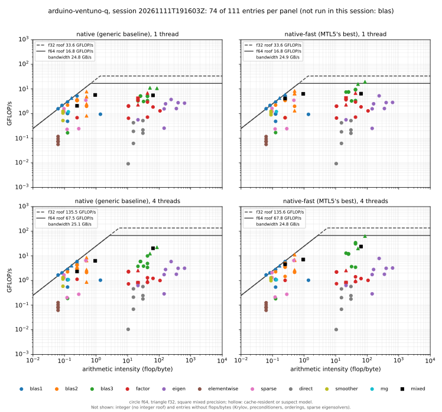

# Benchmark Results — Arduino Ventuno Q

An assessment of the `arduino-ventuno-q` system described on the
[benchmark systems](systems.md#arduino-ventuno-q--arduino-ventuno-q-qualcomm-monaco-4-cortex-a78c--4-cortex-a55)
page: a Qualcomm "Monaco" with 4× Cortex-A78C and 4× Cortex-A55. It is read
from the capability cards of the platform benchmark of #721, and from the
interleave sweeps taken in the same sessions (#780). This is the only machine of the campaign with both GCC and Clang on
AArch64.

**Provenance.** Everything on this page comes from two sessions on 2026-11-11,
except the two 2026-11-13 sections
([#811 and OpenBLAS](#sessions-of-2026-11-13-811-and-openblas),
[native-fast with DotProd](#sessions-of-2026-11-13-native-fast-with-dotprod-806))
and the later figures under [Fixed since these sessions](#fixed-since-these-sessions):
the A/B runs of the fixes and the 2026-11-13 confirmations. The two
2026-11-11 sessions used the same commit and the same build, and the board had
a cold boot between them. The [published card](cards/arduino-ventuno-q.md) has
since moved to the last 2026-11-13 pair, so its figures differ from the ones
quoted outside those sections.

| | |
|---|---|
| Sessions | `20261111T185721Z` and `20261111T191603Z` ([raw data](https://github.com/stillwater-sc/mtl5/tree/main/benchmarks/data/arduino-ventuno-q/mtl5_bench/20261111T191603Z)). The card now shows `20261113T174232Z`, the second of a later pair (the first is `20261113T170450Z`) |
| Commit | `bfa1c2822688` |
| Compiler | GCC 13.3.0, `-O3 -DNDEBUG`, `MTL5_NATIVE_ARCH=ON`. The build ISA is `NEON` without DotProd: GCC 13 resolves `-march=native` to baseline Armv8.0-a on this board (#806). Highway's target is `NEON_WITHOUT_AES`. Clang 18.1.3 ran only the interleave sweep |
| Cores | the four Cortex-A78C, CPUs 0–3, pinned with `taskset`. The A55s (CPUs 4–7) are excluded |
| Clock policy | governor `performance` on the A78C policies: 902–2112 MHz on CPUs 0–1, 940–2361 MHz on CPUs 2–3 |
| Runs | `native` and `native-fast`, each at 1 and 4 threads, class `medium`. CMake found no BLAS/LAPACK on the board, so `platform.sh` skipped the `blas` variant |
| Failed checks | 0 |
| Repeatability | 413 of 444 entries (93.0%) within ±5% between the two sessions; 21 of the 31 outliers are in the 4-thread runs |
| Thermal | 36.3 °C before and 34.8 °C after the 4-thread native-fast run. The board doesn't come near its limit |

## Headline findings

- **native-fast GEMM reaches 57% of the FMA peak on one A78C and scales 3.6×
  on four.** The generic build reaches 30% and scales 2.0×. There is no vendor
  BLAS to compare with on this board.
- **One core saturates memory.** The bandwidth probe reads 24.9 GB/s on one
  core and 24.8 on four. Bandwidth-bound kernels therefore gain little from
  threads: `gemv` gains 1.25–1.35× in native-fast and `spmv` 1.3×. The
  Jetson's single core reaches less than half its module's bandwidth.
- **The threaded LU was 4.4× slower on four cores than on one (#805); #811
  fixed it.** `factor/lu` f64 512×512 took 24.6 ms on one thread and 109 ms
  on four, in both builds and in both sessions. The thread pool's workers
  slept between parallel regions, and the A78C takes 1.5–1.8 ms to leave its
  idle state. In the 2026-11-13 sessions four threads take 17.2 ms, 1.4×
  faster than one. See
  [Sessions of 2026-11-13](#sessions-of-2026-11-13-811-and-openblas).
- **GCC's f32 triangular kernels show #795.** In the generic `native` build,
  the f32 `trsv` takes 20.7 ms against 4.95 ms for f64. Clang on the same board
  doesn't show it. The defaults of #798 set W = 2 for these kernels under GCC
  on AArch64. That brings them to 4.7–4.8 ms, but it leaves them 1.45–1.48× slower
  than Clang's W = 4.

## The 2026-11-11 card by area

The median %roof of each area, from the "Across the runs" section of session
`20261111T191603Z`'s card.
Areas without a roofline are left out.

| area | native 1T | native 4T | native-fast 1T | native-fast 4T |
|---|---:|---:|---:|---:|
| blas1 | 83% | 90% | 94% | 90% |
| blas2 | 55% | 52% | 55% | 57% |
| blas3 | 30% | 9% | 45% | 18% |
| factor | 12% | 2% | 12% | 2% |
| eigen | 15% | 4% | 15% | 4% |
| elementwise | 5% | 5% | 5% | 5% |
| sparse | 30% | 54% | 29% | 55% |
| direct | 1% | 0% | 1% | 0% |
| smoother | 47% | 51% | 47% | 52% |
| mg | 36% | 33% | 37% | 33% |
| mixed | 33% | 30% | 38% | 35% |

- **The memory roof is the same at one and four threads**, so the memory-bound
  areas (`blas1`, `blas2`, `sparse`, `smoother`, `mg`) compare directly between
  the columns. The compute roof is four times higher at four threads.
- **`blas1` and `blas2` are close in the generic build and in native-fast**:
  83% against 94% and 55% against 55% on one core, and within 5 points on
  four. On this board, memory limits the vector kernels more than the
  instructions do.

## Roofline



Each panel places one build's entries at their arithmetic intensity (flops per
byte moved) and their measured GFLOP/s. The rows are 1 thread and all 4
threads. The columns are the generic `native` build, the baseline a
straightforward implementation gives, and `native-fast`, the best MTL5 does.
There is no OpenBLAS column, because CMake found no BLAS/LAPACK on the board.
The lines are each run's own roofs: the measured bandwidth up to the ridge,
then the FMA peak, solid for f64 and dashed for f32. An entry at 100% of its
roof sits on the line. Integer entries are left out, because the model has no
integer ceiling, and so are the 28 entries that record no flops or bytes
(Krylov solvers, preconditioners, orderings and sparse eigensolvers). That
leaves 74 of the 111 entries in each panel.

Across the columns:

- **Level 3 is where the builds separate.** GEMM is at 30% and 57% of the FMA
  peak on one core, and at 15% and 51% on four.
- **The factorizations and eigensolvers don't move**: the `factor` median is
  12% in both builds on one core.
- **The memory-bound entries sit on the slope in both columns.** `blas1` is at
  a median 83% in the generic build and 94% in native-fast.

Within the native-fast column:

- **The memory-bound points line up along the slope, and the slope is the same
  in both panels**: one core already draws the 24.9 GB/s. `blas1` is at a
  median 94% of its roof on one core and 90% on four, the smoothers at 47–52%.
- **Level 3 is the only area near the ceiling.** GEMM is at 57% of the FMA
  peak on one core and 47–51% on four.
- **A few memory-bound points sit slightly above the slope.** The slope is the
  best of three bandwidth probes (triad, read and update), not a hard limit,
  and a kernel with a lighter read/write mix can beat it. `axpy` and `scale`
  reach 101–109%.
- **Points far under the slope at an intensity near 0.06 are the elementwise
  transcendentals** (`sin`, `erf`, `log`, `exp`, `sqrt`). The model counts one
  flop per element, but each costs tens of instructions, so they are compute-
  bound in fact and sit 13–28× under the slope on one core.
- **The compute-bound points other than level 3 sit far under the ceiling**:
  at most a third of it, and the sparse direct solvers under 4%. These are the
  factorizations at 512×512, the dense eigensolvers at 256×256 and the sparse
  direct solvers. Their flop counts are nominal, and most of their time goes
  to panels, pivoting, iteration and indirect access, not to FMAs at full
  width.

## GEMM

`blas3/gemm`, 512×512×512, GFLOP/s and % of the measured FMA peak. The peak is
16.8 GFLOP/s on one A78C in f64 (128-bit NEON, two FMA pipes, at 2.1 GHz) and
67.8 GFLOP/s on four.

| | native | native-fast | native-fast speedup |
|---|---:|---:|---:|
| f64, 1 thread | 4.98 (30%) | 9.52 (57%) | |
| f64, 4 threads | 9.93 (15%) | 34.34 (51%) | 3.6× |
| f32, 1 thread | 10.64 (32%) | 19.39 (58%) | |
| f32, 4 threads | 22.29 (16%) | 63.71 (47%) | 3.3× |

- **Per core, native-fast lands at the Jetson's fraction of the peak** (57%
  against 60%). The A78C's clock gives it 1.5× the Jetson's absolute figure.
- **The register-tile sweep** found 8×4 the best tile on this board, and that
  12×4 loses at four threads
  ([register-tile sweep](register-tile-sweep.md#arduino-ventuno-q-84-wins-and-124-loses-at-four-threads)).
- **Mixed precision** (`mixed/gemm`, f32 inputs and f64 accumulation) reaches
  6.43 GFLOP/s on one core and 24.0 on four in native-fast.

## GCC against Clang

The platform sessions are GCC only. The interleave sweep built the same
generic row kernels with both compilers, on one pinned A78C, n = 4096. The
values are the median of 6 runs over both sessions, in ms, at each compiler's
fastest width.

| kernel | GCC 13.3 | Clang 18.1 | Clang / GCC |
|---|---:|---:|---:|
| gemv f64 | 8.10 (W=4) | 8.25 (W=4) | 1.02 |
| trmv f64 | 4.45 (W=4) | 4.52 (W=4) | 1.02 |
| trisolve f64 | 4.39 (W=4) | 4.48 (W=4) | 1.02 |
| gemv f32 | 5.56 (W=4) | 6.39 (W=4) | 1.15 |
| trmv f32 | 4.76 (W=2) | 3.29 (W=4) | 0.69 |
| trisolve f32 | 4.71 (W=2) | 3.18 (W=4) | 0.68 |

- **Under Clang, W = 4 is the fastest width of every kernel**, and W = 6 is
  18–24% slower. That is the clean AArch64 result behind #798's W = 4 default.
- **Under GCC, f32 `trmv` and forward substitution at W = 4 take 31.7 and
  26.2 ms**: 6.7× and 5.6× slower than at W = 2 (#795). Only W = 2 avoids it,
  so even with #798's GCC exception these two kernels stay 1.45–1.48× behind
  Clang. #795 tracks the likely cause, the `keep_scalar` barrier, which is on
  for GCC on AArch64.
- **The two compilers are within 2% on f64**, and GCC is 15% faster on f32
  `gemv`.

## Fixed since these sessions

**Column-major `gemv` in native-fast (#804).** In these sessions it
takes 49.2 ms on one core against 9.8 ms in the generic build: 5.0× slower,
and the same gap appeared on every machine of the campaign. #809 fixed the
kernel's traversal (see the
[i7-12700K page](i7-12700k.md#column-major-gemv-in-native-fast-804-fixed)). In
its A/B run on this machine (one core, n = 4096), f64 went from 47.52 to
7.74 ms and f32 from 22.77 to 4.10 ms, against 10.06 and 4.74 ms in the
generic build. The 2026-11-13 sessions confirm it: 7.73 ms in native-fast
against 10.03 ms in the generic build, f64, one core.

**The threaded LU (#805).** In these sessions `factor/lu` f64 512×512 is 4.4×
slower on four threads than on one (native-fast 24.6 → 109.1 ms; the generic
build 26.2 → 109.5 ms; the first session 24.7 → 112.4 ms). #811 fixed it; the
[next section](#sessions-of-2026-11-13-811-and-openblas) has the figures.

**The quad integer gemm (#806).** In these sessions `gemm_quad` i8>i32 is
slower than the plain i8 gemm: 11.4 against 16.2 GOP/s on one core, 41.2
against 62.6 on four. Its cause was the build, not the kernel. GCC 13 resolves
`-march=native` to baseline Armv8.0-a here, passing no `-march` or `-mcpu` on
to the compiler, so native-fast had no DotProd and the quad step ran
Highway's emulation of `SDOT`. #819 added `MTL5_NATIVE_ARCH_FLAGS` and the
profile now names the cores' features; the
[last section](#sessions-of-2026-11-13-native-fast-with-dotprod-806) has the
figures.

## Sessions of 2026-11-13: #811 and OpenBLAS

Two more sessions, after OpenBLAS and SuiteSparse were installed on the board.
Their native-fast build was still baseline Armv8.0-a (#806); the
[next section](#sessions-of-2026-11-13-native-fast-with-dotprod-806) has the
pair that fixed it.

| | |
|---|---|
| Sessions | `20261113T131507Z` and `20261113T135246Z`, a cold boot before each |
| Commit | `967d20ac6b04`, after #809 (column-major `gemv`), #811 (the thread pool) and #817 |
| Runs | `native`, `native-fast` and `blas` (OpenBLAS 0.3.26, with CHOLMOD for the reference entries), each at 1 and 4 threads, class `medium`. The same cores, compiler and clock policy as above |
| Failed checks | 0. The 14 PARDISO entries are skipped: MKL is x86-only |
| Repeatability | 780 of 824 entries (94.7%) within ±5% between the two sessions; 26 of the 44 outliers are in the 4-thread runs |

**Threading after #811.** native-fast, f64, the second session of each pair, ms:

| entry | 11-11, 1T | 11-11, 4T | 11-13, 1T | 11-13, 4T | 4T speedup, 11-13 |
|---|---:|---:|---:|---:|---:|
| `factor/lu` | 24.6 | 109.1 | 24.7 | 17.2 | 1.43× |
| `factor/lu_iterative_refine` (f32>f64) | 20.9 | 108.0 | 16.7 | 12.2 | 1.37× |
| `factor/qr` | 250 | 199 | 251 | 147 | 1.70× |
| `factor/lq` | 60.6 | 126.4 | 60.8 | 36.7 | 1.66× |
| `factor/hessenberg` | 348 | 440 | 350 | 200 | 1.75× |
| `factor/householder` | 1.55 | 1.03 | 1.56 | 0.45 | 3.5× |
| `factor/inv` | 143 | 224 | 147 | 127 | 1.16× |
| `factor/cholesky` | 22.3 | 20.1 | 22.4 | 19.9 | 1.12× |

- **Every entry that four threads made slower is now faster on four.** The
  1-thread times are unchanged, except the refinement's, which fell from 20.9
  to 16.7 ms between the pairs. The thread pool's workers now spin for up
  to 1 ms before they sleep (`MTL5_THREAD_POOL_SPIN_US`), so a parallel region
  that follows within that time no longer pays the A78C's 1.5–1.8 ms wake-up.
  The unblocked LU opens one region per column, about 150 that split at
  n = 512, which is why it lost the most.
- **The LU's 1.4× is now in line with the Jetson's** (1.4× on six cores in its
  sessions). It is still modest: the unblocked algorithm has little parallel
  work per column at this size.
- **`factor/cholesky` didn't change.** Its regions were long enough before.

**The OpenBLAS column.** On one core OpenBLAS's `gemm` reaches 89% of the FMA
peak (17.9 GFLOP/s), and native-fast's 57% is 64% of it. At four threads they
are at 80% and 53%. The `factor` median is 41% of the roof in OpenBLAS against
12% in native-fast. LAPACK's LU takes 9.16 ms on one core and 4.10 ms on four,
so MTL5's is 2.7× and 4.2× slower.

**The direct solvers against CHOLMOD** are on the
[direct-solver references](direct-solver-references.md) page.

## Sessions of 2026-11-13: native-fast with DotProd (#806)

Two more sessions after #819, with the native-fast build on the cores' own
features. The [published card](cards/arduino-ventuno-q.md) shows the second.

| | |
|---|---|
| Sessions | `20261113T170450Z` and `20261113T174232Z`, a cold boot before each |
| Commit | `bf315e4`, after #819 (`MTL5_NATIVE_ARCH_FLAGS`) |
| native-fast flags | `-march=armv8.2-a+dotprod+fp16+rcpc -mtune=cortex-a78c`, what `/proc/cpuinfo` lists on every core. The sidecars record `build_isa=NEON DOTPROD` |
| Runs | as in the previous pair. `native` and `blas` don't use `MTL5_NATIVE_ARCH` and are unchanged |
| Failed checks | 0, with the 14 PARDISO entries skipped |
| Repeatability | 780 of 824 entries (94.7%) within ±5% between the two sessions; 30 of the 44 outliers are in the 4-thread runs |

**What DotProd changes.** native-fast, second session of each pair, ms:

| entry | Armv8.0-a, 1T | DotProd, 1T | speedup | Armv8.0-a, 4T | DotProd, 4T | speedup |
|---|---:|---:|---:|---:|---:|---:|
| `integer/gemm_quad` i8>i32 | 23.7 | 3.68 | 6.4× | 5.96 | 0.96 | 6.2× |
| `integer/gemm_quad` u8i8>i32 | 50.9 | 13.6 | 3.8× | 12.7 | 3.32 | 3.8× |
| `integer/dot` i8>i32 | 2.33 | 0.695 | 3.4× | 2.12 | 0.677 | 3.1× |
| `integer/dot` u8i8>i32 | 4.26 | 1.53 | 2.8× | 3.81 | 1.36 | 2.8× |
| `mixed/block_scaled_dot` i8+f32 | 2.65 | 0.755 | 3.5× | 2.37 | 0.962 | 2.5× |
| `smoother/gauss_seidel` f64 | 4.67 | 2.50 | 1.9× | 4.07 | 2.27 | 1.8× |
| `integer/gemm` i8>i32 | 16.6 | 16.6 | 1.0× | 4.19 | 4.20 | 1.0× |
| `blas3/gemm` f64 | 28.1 | 28.3 | 1.0× | 7.43 | 7.43 | 1.0× |

- **`gemm_quad` i8 is now 4.5× faster than the plain i8 gemm** on one core
  (72.8 against 16.2 GOP/s) and 4.4× on four, where it was 30% slower. That is
  the relation the Jetson showed, and for the same reason: its build has
  DotProd. The u8i8 pairing is emulated even with DotProd (`USDOT` needs I8MM,
  which the A78C lacks), but the emulation now builds on `SDOT`/`UDOT` and is
  3.8× faster.
- **The 8-bit dots gain 2.8–3.4×** for the same reason.
- **Native-fast's Gauss–Seidel smoother took 1.9× the generic build's time on
  Armv8.0-a** (4.67 against 2.50 ms) and now matches it (2.50 ms).
- **Everything else is unchanged.** The median native-fast entry moves by
  0.1–0.2%, and no other entry by more than 16% (`blas3/kron`, whose run-to-run
  spread here is about that size). Floating-point FMA and NEON are in
  Armv8.0-a already, so GEMM and the factorizations don't change.

## Caveats

- **The kernel exposes no cache sizes**, so the card's last-level-cache probe
  reads 0. A cache-blocked kernel then runs on its defaults, and the
  cache-blocking A/B was a null run for the same reason
  ([cache-blocking A/B](cache-blocking-ab.md#arduino-ventuno-q-a-null-run-because-there-was-nothing-to-detect)).
- **The two A78C policies have different caps**: 2112 MHz on CPUs 0–1 and
  2361 MHz on CPUs 2–3. A 1-thread run is on CPU 0. A 4-thread run mixes the
  two.
- **The 4-thread runs are less repeatable** than the 1-thread runs: 21 of the
  31 entries outside ±5%.
- **No vendor reference in the 2026-11-11 sessions.** Without OpenBLAS on the
  board then, %roof is the only yardstick for native-fast in them. The
  2026-11-13 sessions have an OpenBLAS column.

## Reproducing

```bash
benchmarks/remote_session.sh <ssh-host> arduino-ventuno-q-platform.sh --reboot --interleave
cmake -DRESULTS=build-platform/remote/arduino-ventuno-q/<session> -DMACHINE=arduino-ventuno-q \
      -P benchmarks/publish_platform.cmake
benchmarks/plot_roofline.py benchmarks/data/arduino-ventuno-q/mtl5_bench/20261111T191603Z \
    --out docs/img/benchmarks/arduino-ventuno-q/roofline-platform.svg
benchmarks/compare_sessions.py benchmarks/data/arduino-ventuno-q/mtl5_bench/20261111T185721Z \
                               benchmarks/data/arduino-ventuno-q/mtl5_bench/20261111T191603Z
```

The [harness README](../../benchmarks/README.md) gives the full session and
publishing steps. The raw results of both sessions are under
`benchmarks/data/arduino-ventuno-q/mtl5_bench/`.
