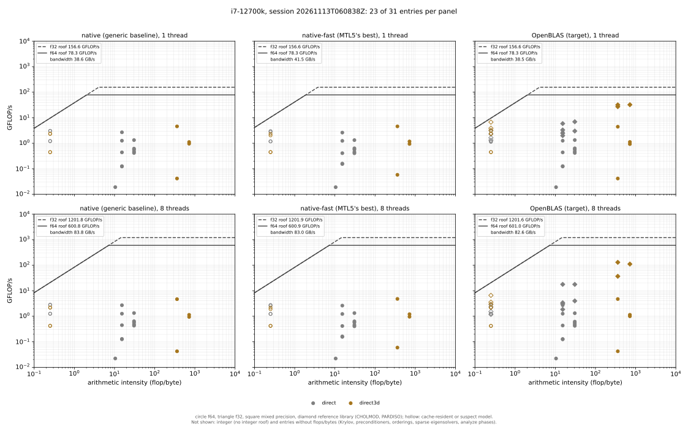

# Sparse direct solvers against CHOLMOD and PARDISO

The `direct` entries of `mtl5_bench` ran at 0.02–1.7% of the roofline, and no
tuned library had been measured on the same problem, so nothing said how much of
that was MTL5 and how much the problem (#810). This page compares MTL5's sparse
direct solvers with CHOLMOD and MKL PARDISO, one phase at a time, on the same
matrices and with the same backward-error check.

**In short.** On the 2D grid, even the references reach only 4–9% of peak in
the factorization: the problem itself caps the percentage. On the 3D grid they
reach 35–41%, and MTL5 is far behind. Its best factorization, the supernodal
LDLᵀ, takes 6× CHOLMOD's time. Its supernodal LU takes 35× PARDISO's, and is
slower than its plain LU. The up-looking Cholesky takes 650× CHOLMOD's time.
The ordering and symbolic analysis are close to the references, and MTL5's
COLAMD-based LU analysis beats PARDISO's. None of MTL5's direct solvers is
faster at 8 threads than at 1.

## The measurement

- **Machine and sessions.** i7-12700K, 8 P-cores, `performance` governor, two
  pinned sessions: `benchmarks/data/i7-12700k/mtl5_bench/20261113T055208Z` and
  `20261113T060838Z`, at `8867b44`, class `medium`. At one thread every direct
  entry agrees between the two sessions within ±2%, except two (3.3% and
  6.1%); at 8 threads within ±6.3%. The tables give the second session.
- **Problems.** Area `direct` is the 96² 2D grid of the one-shot entries
  (9,216 unknowns): the 5-point Laplacian for the SPD solvers, and an
  unsymmetric convection-diffusion operator for the LU solvers. Area `direct3d`
  is the 7-point analogue on a 20³ grid (8,000 unknowns), whose top separator
  has 400 columns against 96 in 2D. 20³ is set by the up-looking
  `sparse_cholesky`, which takes 7.4 s per factorization there and over ten
  minutes at 32³.
- **Phases.** Each solver has an `.analyze` (ordering and symbolic), a
  `.factor` and a `.solve` entry. Earlier phases run untimed, and each check is
  the backward error of a full solve.
- **References** (the `blas` build, with `-DMTL5_BENCH_REFERENCES=ON`):
  - CHOLMOD: supernodal L Lᵀ and AMD, both forced. It calls OpenBLAS.
  - PARDISO: `mtype` 2 for SPD and 11 for unsymmetric. Minimum degree ordering, which is MKL's AMD. MKL's default scaling and matching for `mtype` 11.

  The MTL5 solvers order with AMD (Cholesky, LDLᵀ) and COLAMD (LU).
- **Work model.**
  - Factorization: the Cholesky-equivalent count of the AMD-ordered pattern, doubled for LU. So two solvers on one matrix get the same count, and %roof compares them directly.
  - Solve: 4 nnz(L) flops and 16 nnz(L) bytes.
  - Analysis: no work model, so timed only.

  See `benchmarks/platform/entries_direct.hpp`.

All MTL5 figures below are from the `blas` build, beside the references. They
match the `native` build within 3.4%: none of these solvers calls BLAS here.

## Factorization

One thread, median time, and in parentheses the factor's multiple of the faster
reference:

| problem | `sparse_cholesky` | `supernodal_ldlt` | CHOLMOD | PARDISO SPD |
|---|---:|---:|---:|---:|
| 2D, 96² | 88.4 ms (47×) | 4.18 ms (2.2×) | 3.39 ms | 1.90 ms |
| 3D, 20³ | 7433 ms (768×) | 69.6 ms (7.2×) | 11.4 ms | 9.68 ms |

| problem | `sparse_lu` | `supernodal_lu` | PARDISO LU |
|---|---:|---:|---:|
| 2D, 96² | 35.4 ms (11×) | 47.6 ms (15×) | 3.22 ms |
| 3D, 20³ | 552 ms (29×) | 666 ms (35×) | 19.1 ms |

As a fraction of the f64 FMA peak (78 GFLOP/s on one core):

| problem | `sparse_cholesky` | `supernodal_ldlt` | CHOLMOD | PARDISO SPD | `sparse_lu` | `supernodal_lu` | PARDISO LU |
|---|---:|---:|---:|---:|---:|---:|---:|
| 2D | 0.2% | 3.4% | 4.2% | 7.5% | 0.8% | 0.6% | 8.8% |
| 3D | 0.1% | 5.7% | 34.5% | 40.7% | 1.4% | 1.2% | 41.3% |

- **The 2D grid caps everyone.** Its supernodes are small, so even PARDISO stays
  under 9% of peak. The one-shot entries' 0.02–1.7% is partly the problem: the
  references' one-shots are at 2.5–3.8%.
- **On the 3D grid the references use the hardware.** At 35–41% of peak, their
  dense supernodal updates run as BLAS-3. MTL5's supernodal LDLᵀ reaches 5.7%,
  6× less on the same count.
- **`supernodal_lu` is slower than `sparse_lu`** on both grids, by 21–35%. Its
  supernodes do not pay for themselves here.
- **`sparse_cholesky` is the up-looking algorithm,** one row of L at a time
  with no dense kernel. Its 3D factorization takes 7.4 s, against 70 ms for
  MTL5's own supernodal LDLᵀ on the same matrix.

## Analysis and solve

One thread; the multiple is MTL5's time over the reference's (CHOLMOD for the
SPD solvers, PARDISO for LU):

| entry | 2D | ref | × | 3D | ref | × |
|---|---:|---:|---:|---:|---:|---:|
| `sparse_cholesky.analyze` | 2.36 ms | 1.88 ms | 1.25 | 9.50 ms | 3.91 ms | 2.4 |
| `supernodal_ldlt.analyze` | 4.53 ms | 1.88 ms | 2.4 | 18.7 ms | 3.91 ms | 4.8 |
| `sparse_lu.analyze` | 2.09 ms | 3.59 ms | 0.58 | 4.88 ms | 9.05 ms | 0.54 |
| `supernodal_lu.analyze` | 3.93 ms | 3.59 ms | 1.09 | 11.6 ms | 9.05 ms | 1.29 |
| `sparse_cholesky.solve` | 0.246 ms | 0.327 ms | 0.75 | 1.42 ms | 0.501 ms | 2.8 |
| `sparse_lu.solve` | 0.643 ms | 0.575 ms | 1.12 | 7.51 ms | 1.05 ms | 7.1 |

- **The analysis is close.** MTL5's COLAMD-based LU analysis is about twice as
  fast as PARDISO's ordering of A + Aᵀ. The supernodal LDLᵀ's analysis (AMD,
  then the supernode partition) is the slowest at 4.8× in 3D.
- **The 2D solves are even.** In 3D, the Cholesky solve is 2.8× CHOLMOD's
  (24% of the bandwidth roof against 69%), and the LU solve 7.1× PARDISO's. The
  supernodal solvers' solve times match their plain counterparts, so the
  supernode structure is not used in the solve.

## Threads

8 threads, 3D factorization, session 2:

| solver | 1 thread | 8 threads | speedup |
|---|---:|---:|---:|
| PARDISO SPD | 9.68 ms | 2.38 ms | 4.1× |
| PARDISO LU | 19.1 ms | 5.57 ms | 3.4× |
| CHOLMOD | 11.4 ms | 8.39 ms | 1.4× |
| `supernodal_ldlt` | 69.6 ms | 65.3 ms | 1.07× |
| `supernodal_lu` | 666 ms | 618 ms | 1.08× |
| `sparse_lu` | 552 ms | 540 ms | 1.02× |

MTL5's direct solvers run serially. PARDISO parallelizes over the elimination
tree. CHOLMOD gains only what OpenBLAS's threads give its dense updates.

## Roofline



Areas `direct` (grey) and `direct3d` (brown) only; diamonds are CHOLMOD and
PARDISO, in the OpenBLAS column. The hollow points at the left are the 2D
solves, whose working set fits in cache. The analyze entries have no work
model and are not placed.

## What it points at

These are directions, not measured fixes:

- **A supernodal Cholesky with BLAS-3 updates.** `supernodal_ldlt` is the
  closest MTL5 has, at 6× CHOLMOD in 3D. Its updates do not reach the roof that
  CHOLMOD's dense kernels do.
- **The supernodal LU's updates.** It is slower than the plain LU, so its dense
  path costs more than it saves at these supernode sizes.
- **Threading the factorization** over the elimination tree, where PARDISO gets
  4× on 8 cores.
- **The solves on 3D problems,** 3–7× behind.

## Not covered

- **AArch64.** CHOLMOD was not installed on the Jetson Orin or the Ventuno Q
  when this was measured, and MKL is x86-only, so `ref_cholmod` on ARM is still
  to do (#810).
- **Larger problems.** The `large` class uses 192² and 24³. 32³ and up need a
  faster `sparse_cholesky` first, or that entry left out.
- **Real matrices.** These are generated grids; the SuiteSparse-collection
  matrices of the [KLU and SuperLU scoreboards](../../benchmarks/README.md#sparse-direct-solver-scoreboards)
  are not part of `mtl5_bench`.

## Reproducing

```bash
benchmarks/machines/i7-12700k-platform.sh     # one session; needs SuiteSparse and MKL for the references
benchmarks/plot_roofline.py benchmarks/data/i7-12700k/mtl5_bench/20261113T060838Z \
    --areas direct,direct3d --out docs/img/benchmarks/intel-i7-12700k/roofline-direct.svg
```
