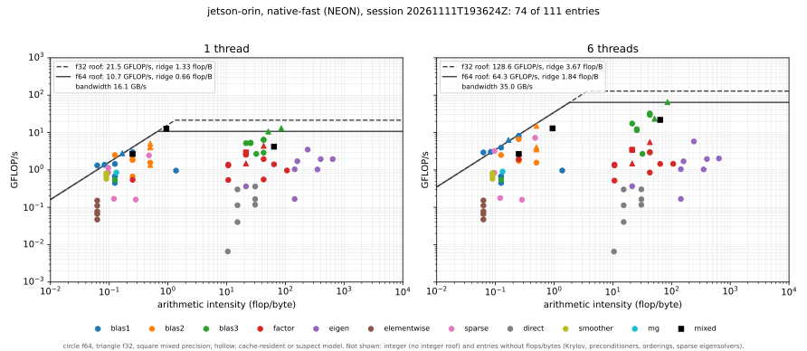

# Benchmark Results — NVIDIA Jetson Orin Nano

An assessment of the `jetson-orin` system described on the
[benchmark systems](systems.md#jetson-orin--jetson-orin-nano-tegra234-6-cortex-a78ae)
page. It is read from the capability cards of the platform benchmark of
#721, and from the interleave sweeps taken in the same sessions (#780).

**Provenance.** Everything on this page comes from two sessions on 2026-11-11,
except [Sessions of 2026-11-13](#sessions-of-2026-11-13-811-and-cholmod) and the
later figures under [Fixed since these sessions](#fixed-since-these-sessions):
the A/B runs of the fixes and the 2026-11-13 confirmations. The two
2026-11-11 sessions used the same commit and the same build, and the machine had
a cold boot between them. The [published card](cards/jetson-orin.md) has since moved to the
2026-11-13 pair, so its figures differ from the ones quoted outside those
sections.

| | |
|---|---|
| Sessions | `20261111T190610Z` and `20261111T193624Z` ([raw data](https://github.com/stillwater-sc/mtl5/tree/main/benchmarks/data/jetson-orin/mtl5_bench/20261111T193624Z)). The card now shows a later pair, `20261113T131507Z` and `20261113T140622Z` |
| Commit | `bfa1c2822688` |
| Compiler | GCC 11.4.0, `-O3 -DNDEBUG`, `MTL5_NATIVE_ARCH=ON`. There is no Clang on this machine |
| Cores | all six Cortex-A78AE, CPUs 0–5, pinned with `taskset` |
| Clock policy | `nvpmodel` 25 W (mode 1) and `jetson_clocks`: all six cores at 1344 MHz |
| Runs | `native`, `native-fast` and `blas` (OpenBLAS), each at 1 and 6 threads, class `medium` |
| Failed checks | 0 |
| Repeatability | 643 of 666 entries (96.5%) within ±5% between the two sessions |

The power mode differs from the earlier cache-blocking A/B on this machine,
which ran at 15 W with unpinned clocks
([cache-blocking A/B](cache-blocking-ab.md#jetson-orin-neutral-and-the-grid-explains-the-one-loss)).
Don't compare figures between the two.

## Headline findings

- **This is the most repeatable machine of the campaign:** 96.5% of entries
  within ±5%, with a median ratio of 1.000 in every run. The outliers are
  dominated by one known effect, the bimodal 6-thread integer gemm (#785).
- **native-fast GEMM reaches 60% of the FMA peak on one core and 64% of
  OpenBLAS.** OpenBLAS is at 94% of peak. With six threads native-fast scales
  5.0× and stays at 58% of OpenBLAS.
- **One core reaches less than half the memory bandwidth.** A single core
  streams 16.1 GB/s, against 35.0 GB/s for all six. Bandwidth-bound kernels
  therefore gain from threads here: `gemv` gains 2.6–3.0×, while on the
  Ventuno's A78C, where one core already saturates memory, it gains 1.3×.
- **GCC's f32 triangular kernels show #795.** In the generic `native` build,
  f32 `trmv` and `trsv` take 26.5 and 26.9 ms against 12.0 ms for f64. Halving
  the data should make f32 faster, not 2.2× slower. The per-ISA defaults of
  #798 set these kernels to W = 2 under GCC on AArch64, which the interleave
  sweep measures at 6.8–6.9 ms. They postdate these sessions.
- **native-fast column-major `gemv` was 3.2× slower than the generic build**:
  50.1 ms against 15.6 ms, on every machine of the campaign. #809 fixed it
  (#804); see [Fixed since these sessions](#fixed-since-these-sessions).

## The 2026-11-11 card by area

The median %roof of each area, from the "Across the runs" section of session
`20261111T193624Z`'s card.
Areas without a roofline (orderings, Krylov, preconditioners, sparse
eigensolvers, integer) are left out. Their times are in that card.

| area | native 1T | native 6T | native-fast 1T | native-fast 6T | blas 1T | blas 6T |
|---|---:|---:|---:|---:|---:|---:|
| blas1 | 72% | 91% | 74% | 93% | 72% | 91% |
| blas2 | 35% | 51% | 50% | 23% | 64% | 60% |
| blas3 | 33% | 6% | 50% | 19% | 89% | 72% |
| factor | 13% | 2% | 13% | 2% | 42% | 11% |
| eigen | 16% | 3% | 16% | 3% | 37% | 7% |
| elementwise | 8% | 4% | 8% | 4% | 8% | 4% |
| sparse | 31% | 26% | 32% | 25% | 32% | 26% |
| direct | 1% | 0% | 1% | 0% | 1% | 0% |
| smoother | 49% | 22% | 49% | 22% | 49% | 22% |
| mg | 40% | 20% | 40% | 20% | 40% | 20% |
| mixed | 33% | 15% | 66% | 34% | 33% | 15% |

How to read it:

- **The 6-thread compute roof is six times the 1-thread one**, so a
  compute-bound area that doesn't thread drops by up to 6× in this table
  without getting any slower. The memory roof grows only 2.2× (16.1 to
  35.0 GB/s). That is
  most of the drop in `factor`, `eigen` and `direct`: at 512×512 the native
  factorizations gain 1.4× from six threads, OpenBLAS's LU 2.4×.
- **blas1 is near the bandwidth roof in every build.** The vector kernels
  don't depend on the build.
- **blas2 at 6 threads, native-fast (23%) is below native (51%).** Most of
  the gap is the column-major `gemv`: 20% of the roof in native-fast against
  59% in native. The row-major `gemv` is at 76% (f64) and 86% (f32). `trmv` and
  `trsv` don't gain from threads in either build.

## Roofline



Each panel places one build's entries at their arithmetic intensity (flops per
byte moved) and their measured GFLOP/s. The rows are 1 thread and all 6
threads. The columns are the generic `native` build, the baseline a
straightforward implementation gives; `native-fast`, the best MTL5 does; and
the `blas` build, where OpenBLAS and its LAPACK take the dense kernels: what
tuned libraries reach, and so MTL5's target. The lines are each run's own
roofs: the measured bandwidth up to the ridge, then the FMA peak, solid for
f64 and dashed for f32. An entry at 100% of its roof sits on the line. Integer
entries are left out, because the model has no integer ceiling, and so are the
28 entries that record no flops or bytes (Krylov solvers, preconditioners,
orderings and sparse eigensolvers). That leaves 74 of the 111 entries in each
panel.

Across the columns:

- **Level 3 is where the builds separate.** GEMM is at 33%, 60% and 94% of the
  FMA peak on one core, and at 18%, 50% and 86% on six. native-fast closes
  44–47% of the gap from the baseline to OpenBLAS.
- **The factorizations and eigensolvers rise only in the OpenBLAS column**,
  where LAPACK takes them. The `factor` median is 13% in both MTL5 builds and
  42% with OpenBLAS; LU f64 is at 23–24% against 61%.
- **The memory-bound entries sit on the slope in every column.** `blas1` is at
  a median 72%, 74% and 72%. Where bandwidth is the limit, the build matters
  little.
- **The elementwise kernels and the sparse direct solvers don't move between
  columns**, because no build replaces them: 8% and 1% in all three.

Within the native-fast column:

- **The memory-bound points line up along the slope.** On one core the `blas1`
  entries are at a median 74% of their roof, `blas2`, the smoothers and the
  V-cycle at 40–50%. At six threads the slope rises to the module's 35 GB/s;
  `blas1` follows it (93%), and the kernels that don't thread fall away from
  it.
- **Level 3 is the only area near the ceiling.** GEMM is at 60% of the FMA
  peak on one core and 50% on six, and the other level-3 kernels at 512³
  between 25% and 59% on one core.
- **A few memory-bound points sit slightly above the slope.** The slope is the
  best of three bandwidth probes (triad, read and update), not a hard limit,
  and a kernel with a lighter read/write mix can beat it. On one core `scale`
  is at 131% and `ger` at 124%.
- **`mixed/block_scaled_dot` (i8 and f32) is above its ceiling** at 118% on
  one core. Its roof is the f64 FMA peak, which an i8 kernel isn't bound by.
- **Points far under the slope at an intensity near 0.06 are the elementwise
  transcendentals** (`sin`, `erf`, `log`, `exp`, `sqrt`). The model counts one
  flop per element, but each costs tens of instructions, so they are compute-
  bound in fact and sit 7–21× under the slope on one core.
- **The compute-bound points other than level 3 sit far under the ceiling**:
  at most a third of it, and the sparse direct solvers under 4%. These are the
  factorizations at 512×512, the dense eigensolvers at 256×256 and the sparse
  direct solvers. Their flop counts are nominal, and most of their time goes
  to panels, pivoting, iteration and indirect access, not to FMAs at full
  width.

## GEMM

`blas3/gemm`, 512×512×512, GFLOP/s and % of the measured FMA peak. The peak is
10.7 GFLOP/s per core in f64 (128-bit NEON, two FMA pipes, at 1344 MHz) and
64.3 GFLOP/s on six cores.

| | native | native-fast | OpenBLAS | native-fast / OpenBLAS |
|---|---:|---:|---:|---:|
| f64, 1 thread | 3.56 (33%) | 6.46 (60%) | 10.08 (94%) | 64% |
| f64, 6 threads | 11.73 (18%) | 32.44 (50%) | 55.58 (86%) | 58% |
| f32, 1 thread | 7.02 (33%) | 13.06 (61%) | 20.48 (96%) | 64% |
| f32, 6 threads | 20.91 (16%) | 65.07 (51%) | 107.46 (84%) | 61% |

- **native-fast scales 5.0× on six cores**, against OpenBLAS's 5.5×. Its
  parallel decomposition holds up. The gap to OpenBLAS is the single-core
  kernel's.
- **The 1-thread figure matches the earlier A/B session.** That session
  measured 6.7 GFLOP/s at 15 W and up to 1497.6 MHz
  ([systems](systems.md#jetson-orin--jetson-orin-nano-tegra234-6-cortex-a78ae)).
  This one measured 6.46 at 1344 MHz. The kernel reaches about the same
  fraction of the core either way.
- **Mixed precision** (`mixed/gemm`, f32 inputs and f64 accumulation) reaches
  4.19 GFLOP/s on one core in native-fast and 21.9 on six.

## Memory-bound kernels and threading

| probe | 1 thread | 6 threads |
|---|---:|---:|
| bandwidth (the best of triad, read and update), GB/s | 16.1 | 35.0 |
| `gemv` f64, native-fast, GFLOP/s (%roof) | 2.39 (59%) | 6.63 (76%) |
| `gemv` f32, native-fast | 5.06 (63%) | 15.10 (86%) |
| `gemv` f64, OpenBLAS | 2.66 (66%) | 7.27 (83%) |

A single A78AE can't draw the module's bandwidth, so the threaded memory-bound
kernels gain 2–3× here. That matters to a solver, because its inner loops are
`spmv`, `dot` and `axpy`. `spmv` gains 2.8× (94.7% of the 6-thread roof in
native-fast). The smoothers and the multigrid V-cycle gain nothing from six
threads (1.0–1.1×), so their %roof halves when the roof doubles.

## Interleave width and #795

From [Interleave width across the benchmark machines](interleave-width.md):
GCC, one pinned core, n = 4096, median of 6 runs over both sessions, in ms.

| kernel | W=2 | W=4 | W=6 (default at the time) | fastest |
|---|---:|---:|---:|---|
| gemv f64 | 13.60 | **12.89** | 19.94 | 4 |
| trmv f64 | **7.98** | 8.98 | 12.55 | 2 |
| trisolve f64 | **7.80** | 8.71 | 12.43 | 2 |
| gemv f32 | 13.21 | **7.74** | 12.24 | 4 |
| trmv f32 | **6.93** | 49.78 | 11.05 | 2 |
| trisolve f32 | **6.80** | 39.43 | 27.04 | 2 |

- **W = 6 was 1.5–1.6× slower than the fastest width in every f64 kernel.**
- **The defaults of #798 give** W = 4 for f64 and f32 `gemv` and for f64 `trmv`
  and forward substitution, and W = 2 for f32 `trmv` and forward substitution
  under GCC. That leaves f64 `trmv` and forward substitution 12% from their
  fastest width (W = 2). Run-time selection (#778) would recover it.
- **f32 at W = 4 is 7.2× slower than at W = 2.** That is #795, still open. Its
  likely cause is the `keep_scalar` barrier, which is on for GCC on AArch64.

## Integer gemm: two modes at six threads (#785)

At six threads, two integer gemm entries run in one of two stable modes per
process. The repetitions within one process agree to under 0.5%, but a new
process can land in a mode 1.4–2× slower. The published session caught the
slow mode of both:

| entry, 6 threads | session 1 | session 2 |
|---|---:|---:|
| `integer/gemm` i16>i32 512³ | 7.09 ms | 14.07 ms |
| `integer/gemm` i32 512³ | 9.00 ms | 12.79 ms |

Single-threaded, both are stable across the sessions. Clocks, temperature and
session state were ruled out, and #785 lists the hypotheses: buffer placement,
the uneven 512/6 row split, and false sharing on C. #785 is closed without a
fix. Read a 6-thread integer gemm figure on this machine as one of two values.

## Fixed since these sessions

**The quad integer gemm, read the wrong way round (#806).** `gemm_quad` i8>i32,
the 4-way multiply-accumulate, is 3.9× faster than the plain i8 gemm in
native-fast (31.4 against 8.0 GOP/s on one core). This page used to call that
the emulated path, and the Ventuno's reversal the native one. The sidecars say
the opposite: this build's ISA is `NEON DOTPROD`, so its quad gemm is the
native `SDOT` path, and the Ventuno's build was baseline Armv8.0-a, because GCC
13 under-detects that board. With its features named, the Ventuno's quad gemm
is 4.5× its plain one
([Ventuno page](arduino-ventuno-q.md#sessions-of-2026-11-13-native-fast-with-dotprod-806)).

**Column-major `gemv` in native-fast (#804).** In these sessions it
takes 50.1 ms on one core against 15.6 ms in the generic build and 12.9 ms in
OpenBLAS; the same gap appeared on every machine of the campaign. #809 fixed
the kernel's traversal (see the
[i7-12700K page](i7-12700k.md#column-major-gemv-in-native-fast-804-fixed)). In
its A/B run on this machine (one core, n = 4096), f64 went from 63.92 to
17.78 ms and f32 from 31.40 to 7.93 ms, against 21.47 and 8.27 ms in the
generic build. The 2026-11-13 sessions confirm it: 12.9 ms in native-fast
against 16.3 ms in the generic build and 13.0 ms in OpenBLAS, f64, one core.

## Sessions of 2026-11-13: #811 and CHOLMOD

Two more sessions, after SuiteSparse was installed, for the CHOLMOD reference
entries of #810. The [published card](cards/jetson-orin.md) shows the second.

| | |
|---|---|
| Sessions | `20261113T131507Z` and `20261113T140622Z`, a cold boot before each |
| Commit | `967d20ac6b04`, after #809 (column-major `gemv`), #811 (the thread pool) and #817 (the CHOLMOD 3 build) |
| Runs | as above, with CHOLMOD 3.0 (SuiteSparse 5.10) in the `blas` build; OpenBLAS 0.3.20 |
| Failed checks | 0. The 14 PARDISO entries are skipped: MKL is x86-only |
| Repeatability | 793 of 824 entries (96.2%) within ±5% between the two sessions; 27 of the 31 outliers are in the 6-thread runs |

- **#811 changes little here.** native-fast `factor/lu` f64 512×512 takes
  35.9 ms on one thread and 24.9 ms on six, against 35.3 and 26.0 ms on
  2026-11-11. The #811 A/B measured 38.1 → 26.7 ms at six threads on this
  board, but the platform sessions never showed that slowdown: 26.0 ms on
  2026-11-11 already.
- **CHOLMOD's factorization is 3.7–5.7× slower on six threads than on one.**
  The 3D grid's takes 79 ms on one thread and 295–453 ms on six. CHOLMOD 3 has
  no thread team of its own, so the threads are OpenBLAS's. One diagnostic
  run on the idle board after the sessions, 3D factorization:

  | MTL5 pool | OpenBLAS | time |
  |---:|---:|---:|
  | 1 | 1 | 72 ms |
  | 6 | 6 | 299 ms |
  | 6 | 6, `MTL5_THREAD_POOL_SPIN_US=0` | 305 ms |
  | 6 | 1 | 72 ms |
  | 1 | 6 | 367 ms |
  | 1 | 2 | 58 ms |

  MTL5's pool and #811's spin make no difference, and two OpenBLAS threads are
  faster than one. So it is OpenBLAS 0.3.20's threading
  of CHOLMOD's small dense updates on this board. The Ventuno's OpenBLAS 0.3.26
  gains 1.6× on four cores. Read the 6-thread `ref_cholmod` figures here as
  that effect, not as CHOLMOD's.
- **The direct solvers against CHOLMOD** are on the
  [direct-solver references](direct-solver-references.md) page.

## Caveats

- **GCC 11 only.** The AArch64 compiler comparison is on the
  [Ventuno Q](arduino-ventuno-q.md#gcc-against-clang), which has both.
- **The cards' last-level cache is 2 MiB**, one cluster's L3. The 4 MiB system
  cache that sysfs doesn't expose isn't in the model.
- **These are 25 W numbers.** The module's other power modes change both the
  clock cap and the online cores.
- **`medium` class sizes** (512³ for dense level 3) are small for six threads.
  The cards aren't a large-N scaling study.

## Reproducing

```bash
benchmarks/remote_session.sh <ssh-host> jetson-orin-platform.sh --reboot --interleave
cmake -DRESULTS=build-platform/remote/jetson-orin/<session> -DMACHINE=jetson-orin \
      -P benchmarks/publish_platform.cmake
benchmarks/plot_roofline.py benchmarks/data/jetson-orin/mtl5_bench/20261111T193624Z \
    --out docs/img/benchmarks/jetson-orin/roofline-platform.svg
benchmarks/compare_sessions.py benchmarks/data/jetson-orin/mtl5_bench/20261111T190610Z \
                               benchmarks/data/jetson-orin/mtl5_bench/20261111T193624Z
```

The [harness README](../../benchmarks/README.md) gives the full session and
publishing steps. The raw results of both sessions are under
`benchmarks/data/jetson-orin/mtl5_bench/`.
