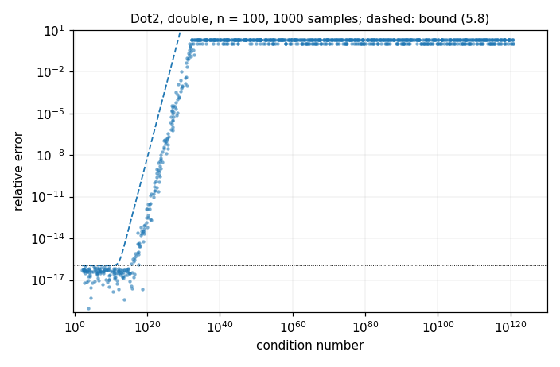
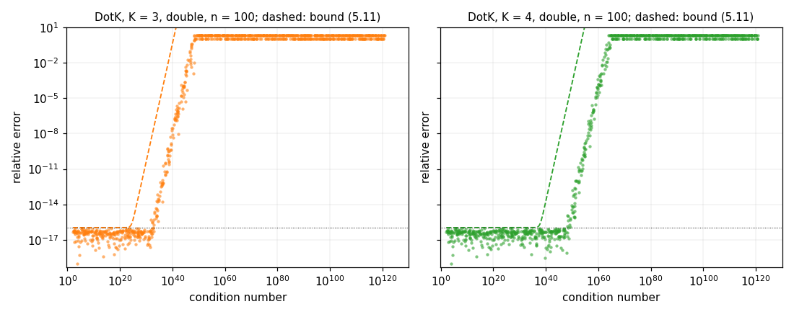
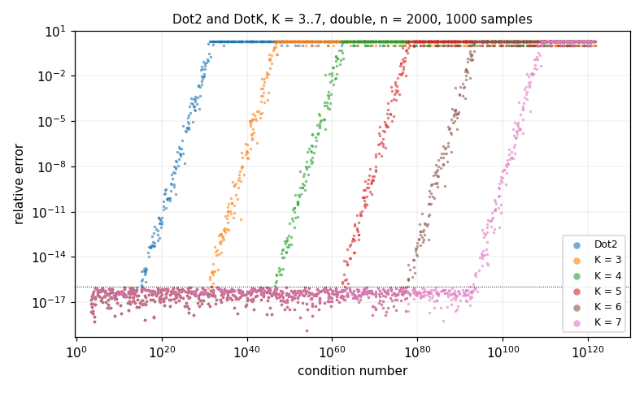
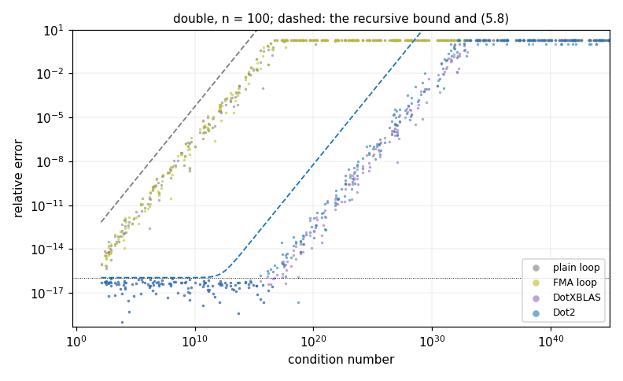
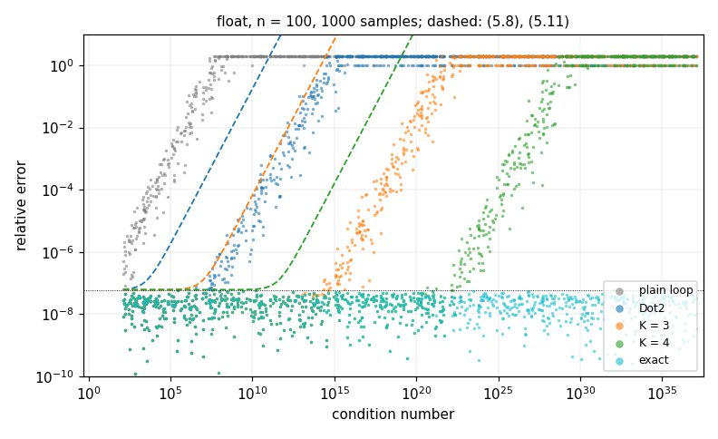
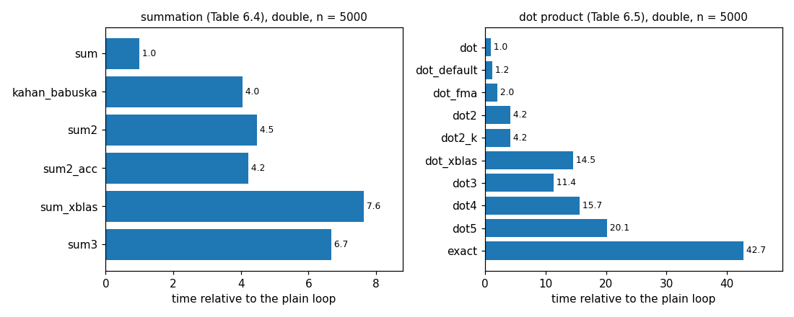

# Accurate Sum and Dot Product

How accurate is a dot product? With the plain loop, it depends on the condition number: in double precision, a dot product with condition number 1e16 has no correct digits left. Ogita, Rump and Oishi showed how to compute sums and dot products **as if in K-fold working precision**, using only working-precision arithmetic and error-free transformations: T. Ogita, S. M. Rump and S. Oishi, "Accurate sum and dot product", *SIAM J. Sci. Comput.* 26(6), 2005.

`examples/accurate_sum_dot/accurate_sum_dot.cpp` reruns the experiments of the paper's Section 6 with MTL5's implementations of its algorithms, on test data from its own generator, and checks every result against an exact reference. This page shows what it finds.

## The algorithms

| | MTL5 | the paper |
|---|---|---|
| plain loop | `mtl::dot<T, T>(x, y)`, `mtl::sum(p)` | DSum |
| FMA loop | `mtl::dot<math::fma_accumulator<T>, T>(x, y)` | |
| twice the working precision | `mtl::dot<math::compensated_accumulator<T>, T>(x, y)`, `mtl::sum_k<2>(p)` | Dot2 (Algorithm 5.3), Sum2 (Algorithm 4.4) |
| K-fold working precision | `mtl::dot_k<K>(x, y)`, `mtl::sum_k<K>(p)` | DotK (Algorithm 5.10), SumK (Algorithm 4.8) |
| exact, rounded once | `mtl::dot<math::exact_accumulator<T>, T>(x, y)` | |
| double-double (XBLAS) | local to the example | DotXBLAS (Algorithm 5.6), SumXBLAS (Algorithm 4.6) |
| Kahan-Babuška | local to the example | K-B |

The building blocks (`two_sum`, `two_product` and the others) and the error bounds are described in [Error-Free Transformations](../architecture/error-free-transformations.md). The test data comes from `generators::gen_dot` and `generators::gen_sum`, the paper's GenDot (Algorithm 6.1), described in [Ill-Conditioned Sums and Dot Products](../generators/ill-conditioned.md).

The condition number of a dot product is `cond(xᵀy) = 2·|x|ᵀ|y| / |xᵀy|` (5.7), and that of a sum is `Σ|pᵢ| / |Σpᵢ|` (4.9). Every figure below plots against the condition number each sample **achieved**, computed exactly, as the paper does.

## Running it

```bash
cmake -B build-release -DCMAKE_BUILD_TYPE=Release -DMTL5_BUILD_EXAMPLES=ON
cmake --build build-release --target example_accurate_sum_dot -j4
./build-release/examples/example_accurate_sum_dot --out results
python3 examples/accurate_sum_dot/plot_accurate_sum_dot.py results --out docs/img
```

- `--out DIR` sets where the CSV files go; `--samples N` sets the number of dot products per sweep (default 1000, as in the paper); `--quick` makes a run of about a second, for a smoke test.
- A default run takes about 40 seconds in a Release build. The timings need a Release build.
- The plot script needs only Python and matplotlib.

The example writes five CSV files:

| file | content |
|---|---|
| `dot_double_n100.csv`, `dot_double_n2000.csv`, `dot_float_n100.csv` | one row per GenDot sample: the requested and achieved condition numbers, each algorithm's relative error, and each algorithm's bound |
| `sum_digits.csv` | one row per GenSum sum: the achieved condition number and each summation algorithm's correct digits |
| `timing.csv` | nanoseconds per call and the ratio to the plain loop, per algorithm and length |

**How errors are measured.** The relative error `|res − xᵀy| / |xᵀy|` is computed exactly: `res` is subtracted inside an exact accumulator that holds `xᵀy`, and only the difference is rounded. As in the paper, a relative error greater than 2 is set to 2. In the plots, an error of exactly 0 is drawn at 1e-19, and the dotted horizontal line is eps (2^-53 in double, 2^-24 in float).

The results below are from an Intel Core i7-12700K, GCC 15.2, Release build. The accuracy results do not depend on the machine: the generator draws the same numbers on every platform, and the CSV files from GCC and Clang are bit-identical.

## Dot2: twice the working precision (Figure 6.1)



This reproduces Figure 6.1: 1000 GenDot products of length 100, with condition numbers up to 1e120. Dot2's result is accurate to about eps up to a condition number of about 1/eps ≈ 1e16. Between 1/eps and 1/eps² ≈ 1e32, the error grows linearly with the condition number until no correct digit is left.

The dashed line is the bound (5.8) from Corollary 5.7:

`|res − xᵀy| / |xᵀy| ≤ eps + ½·γ_n²·cond(xᵀy)`, where `γ_n = n·eps / (1 − n·eps)`.

No sample exceeds it. The paper finds the bound pessimistic by 2 or 3 orders of magnitude beyond 1/eps. Here, over the samples with an error between 1e-14 and 1e-2, the median gap between bound and error is 4.1 orders of magnitude.

## DotK: K-fold working precision (Figures 6.2 and 6.3)



The same test for DotK with K = 3 and K = 4. Each stays accurate to about eps up to a condition number of about eps^-(K−1), and then degrades over the next 16 decades. The dashed line is the bound (5.11) from Proposition 5.11:

`|res − xᵀy| / |xᵀy| ≤ eps + 2·γ_{4n−2}² + ½·γ_{4n−2}^K·cond(xᵀy)`.

No sample exceeds it either. As the paper notes, the bound grows more pessimistic as K grows. The median gap in the degrading region is 7.8 orders of magnitude for K = 3 and 10.3 for K = 4, at n = 100. The paper reports "some 10 orders of magnitude" beyond eps^-4.

## Length 2000, K up to 7 (Figure 6.4)



The paper's Figure 6.4 repeats the test with vectors of length 2000 and shows Dot2 and DotK for K = 3 to 7 together. The algorithms behave as at length 100: each extra K moves the curve about 16 decades to the right.

The paper observes that for K = 7, the result is still of maximum accuracy up to a condition number of 1e93. In this run, the largest condition number at which DotK with K = 7 has an error of at most eps is 9.0e93.

| | last sample with error ≤ eps, n = 100 | first sample with error ≥ 1, n = 100 | last with error ≤ eps, n = 2000 |
|---|---|---|---|
| Dot2 | 4.8e18 | 3.6e31 | 2.8e15 |
| DotK, K = 3 | 8.0e32 | 1.5e48 | 3.4e31 |
| DotK, K = 4 | 6.7e48 | 8.2e63 | 2.0e48 |
| DotK, K = 5 | 1.7e65 | 1.7e79 | 1.1e63 |
| DotK, K = 6 | 2.0e81 | 5.4e95 | 1.4e79 |
| DotK, K = 7 | 2.6e97 | 2.3e112 | 9.0e93 |

Over all 3000 dot products of the three sweeps, no algorithm exceeds its bound.

## The working-precision loops, and XBLAS



The paper does not plot the plain loop, but it shows where the gain comes from. The plain loop (grey) and the FMA loop (yellow) lose a digit with every decade of condition number, from the start, and stay within the classical bound `γ_n·cond / 2` (dashed grey). The FMA loop rounds half as often but is no more accurate here. What limits it is the condition number, not the number of roundings.

XBLAS's double-double dot product (Algorithm 5.6) gives results similar to Dot2. The paper notes that for condition numbers well above 1/eps, XBLAS's summation is up to one digit better than Sum2. DotXBLAS shows the same here: for condition numbers from 1e20 to 1e30, its median error is 2.1e-8 against Dot2's 5.5e-8. It costs more than three times as much (see the timings). The paper proves no bound for XBLAS, so it has no dashed line.

## In float



The paper works in double only. The same algorithms in float, with eps = 2^-24, scale as expected. The plain loop fails near a condition number of 1e7, Dot2 near 1e14, and DotK with K = 3 and K = 4 near 1e21 and 1e28. The bounds (5.8) and (5.11), evaluated with float's eps, hold for every sample. Condition numbers stop at about 1e37, the limit of float's exponent range for GenDot.

## Summation: correct digits (Table 6.2)

Table 6.2 of the paper lists the number of correct decimal digits, `−log10(relative error)`, set to 0 when negative. The rows are condition numbers 1e7, 1e14, 1e21 and 1e28, and the lengths n run from 100 to 5000 in steps of 100. An exact result counts as 16 digits. The sums come from `gen_sum`. Each entry is the median, with the median absolute deviation in parentheses.

| requested cond | achieved (median) | sum | Kahan-Babuška | Sum2 | SumXBLAS | Sum3 |
|---|---|---|---|---|---|---|
| 1e7 | 2.7e8 | 7.6 (0.6) | 8.7 (0.4) | 16.0 (0.0) | 16.0 (0.0) | 16.0 (0.0) |
| 1e14 | 1.3e15 | 1.0 (0.5) | 2.0 (0.4) | 16.0 (0.0) | 16.0 (0.0) | 16.0 (0.0) |
| 1e21 | 1.3e22 | 0.0 (0.0) | 0.0 (0.0) | 9.0 (0.5) | 10.0 (0.4) | 16.0 (0.0) |
| 1e28 | 1.2e29 | 0.0 (0.0) | 0.0 (0.0) | 2.1 (0.6) | 3.0 (0.4) | 16.0 (0.0) |
| **paper** | | | | | | |
| 1e7 | | 8.9 (0.3) | 9.8 (0.2) | 16.0 (0.0) | 16.0 (0.0) | 16.0 (0.0) |
| 1e14 | | 2.0 (0.3) | 2.9 (0.2) | 16.0 (0.0) | 16.0 (0.0) | 16.0 (0.0) |
| 1e21 | | 0.0 (0.0) | 0.0 (0.0) | 10.3 (0.5) | 11.1 (0.3) | 16.0 (0.0) |
| 1e28 | | 0.0 (0.0) | 0.0 (0.0) | 3.8 (0.4) | 4.3 (0.4) | 16.0 (0.0) |

The pattern is the paper's:
- The plain sum keeps about `16 − log10(cond)` digits, and Kahan-Babuška improves that by about one digit.
- Sum2 and SumXBLAS are fully accurate up to about 1e16. Beyond that, SumXBLAS is up to a digit better than Sum2.
- Sum3 is fully accurate throughout.

Wherever the result depends on the condition number, MTL5 comes out about one digit below the paper. The achieved column explains it. GenDot typically reaches about 10 times the requested condition number, as the paper's own Table 6.1 reports, and each decade costs a digit. The paper's rows appear to be labelled by the condition number reached, not the one requested. The example uses 4 sums per length and condition number, where the paper used some 1000; `--samples` raises it.

## Computing time (Tables 6.4 and 6.5)



Times are relative to MTL5's plain loop. Each is the fastest of 7 trials.

| summation | n = 100 | n = 1000 | n = 5000 | paper: env. I / env. II / flops |
|---|---|---|---|---|
| Kahan-Babuška | 6.6 | 4.2 | 4.0 | 4.3 / 3.4 / 4 |
| Sum2 (`sum_k<2>`) | 9.4 | 4.6 | 4.5 | 7.1 / 5.1 / 7 |
| Sum2 (compensated accumulator) | 8.7 | 4.5 | 4.2 | |
| SumXBLAS | 15.0 | 8.1 | 7.6 | 15.5 / 8.3 / 10 |
| Sum3 (`sum_k<3>`) | 14.2 | 7.0 | 6.7 | 16.7 / 11.3 / 13 |

| dot product | n = 100 | n = 1000 | n = 5000 | paper: env. I / env. II / flops |
|---|---|---|---|---|
| default `mtl::dot` | 2.6 | 1.3 | 1.2 | |
| FMA loop | 2.8 | 2.1 | 2.0 | |
| Dot2 (compensated accumulator) | 6.1 | 4.4 | 4.2 | 13.5 / 22.7 / 12.5 |
| DotXBLAS | 20.2 | 15.2 | 14.5 | 18.5 / 38.3 / 18.5 |
| DotK, K = 3 | 15.9 | 11.7 | 11.4 | 21.3 / 38.0 / 18.5 |
| DotK, K = 4 | 22.0 | 16.3 | 15.7 | 28.2 / 48.7 / 24.5 |
| DotK, K = 5 | 28.3 | 21.0 | 20.1 | 35.1 / 59.0 / 30.5 |
| exact accumulator | 56.3 | 43.6 | 42.7 | |

The plain loops take about 2 µs at n = 5000.

**How these compare with the paper.**
- **Baseline.** The paper's dot product times are relative to a BLAS DDOT. These are relative to MTL5's scalar loop, which on this machine is faster than the default `mtl::dot` path.
- **FMA.** `math::two_product` uses a fused multiply-add (Algorithm 3.5), where the paper counts Dekker's TwoProduct (Algorithm 3.3). Dot2 then takes about 10n flops rather than the paper's `25n − 7` (Proposition 5.5), against 2n for the plain loop. Accordingly it measures about 4 times the plain loop, not the 12.5 times of the paper's flop count.
- **Accuracy per cost.** XBLAS costs more than Dot2 for about the same accuracy, and DotK with K = 3 costs less than XBLAS for one more working precision, as the paper found.
- **Workspace.** `sum_k` and `dot_k` copy their input to a workspace of n or 2n values. That copy is part of the time measured. The compensated accumulator streams Sum2 without one and is slightly faster.
- **The exact accumulator.** It costs about 43 times the plain loop and is exact at every condition number. DotK up to K = 5 is cheaper, and accurate up to the condition numbers in the table above.

## Related

- [Error-Free Transformations](../architecture/error-free-transformations.md): `two_sum`, `two_product`, the compensated accumulator, `sum_k` and `dot_k`, and the theorems the tests assert
- [Ill-Conditioned Sums and Dot Products](../generators/ill-conditioned.md): `gen_dot` and `gen_sum`
- [Exact Accumulator](../architecture/exact-accumulator.md): the exact reference
- [#611](https://github.com/stillwater-sc/mtl5/issues/611): reproducing Ogita, Rump and Oishi; [The Accuracy Architecture](../architecture/accuracy-architecture.md) (#596)
