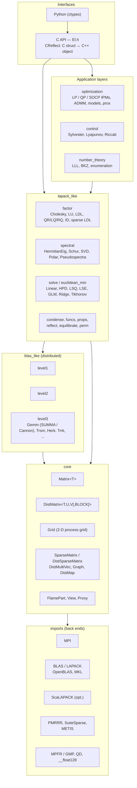
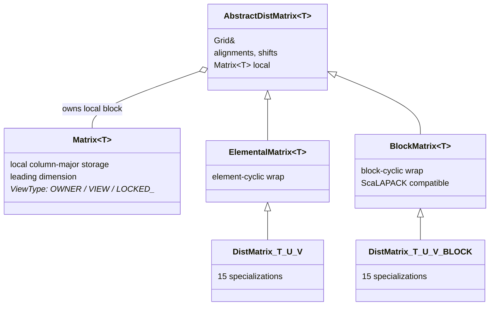
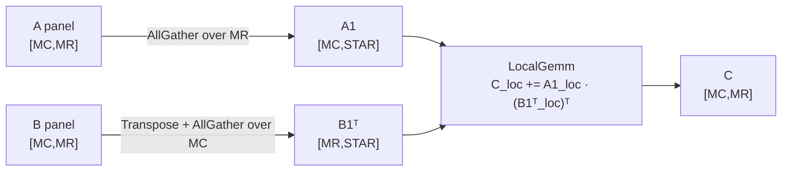
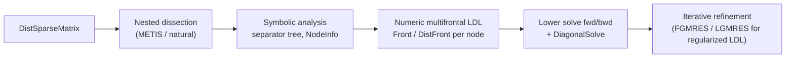

# Elemental — Software Architecture and Linear Algebra Feature Set

## Background

[Elemental](https://github.com/elemental/Elemental) is a C++11 library for distributed-memory dense and sparse-direct linear algebra, conic optimization, and lattice reduction, built on MPI. All public API lives in namespace `El` (version 0.88-dev, BSD 2-Clause).

This document is a survey of its core architecture and algorithm inventory, based on a read of the source tree at commit `00c642074` (~277 `.cpp` files and ~137K lines in `src/`, ~430 headers in `include/`). It was compiled from the directory layout and public headers; the code was not built or benchmarked.

Elemental grew out of the FLAME methodology: blocked algorithms are expressed as sweeps over matrix partitions, and interprocess communication is expressed as *changes of data distribution*.

---

## 1. Layered Architecture



`El-lite.hpp` gives you only core and BLAS. `El.hpp` gives you everything. The `src/` tree mirrors `include/El/`.

| Directory | Contents |
|---|---|
| `include/El/core/` | `Matrix`, `DistMatrix`, `Grid`, sparse types, MPI/BLAS/LAPACK wrappers |
| `include/El/blas_like/` | Level 1/2/3 BLAS-style operations |
| `include/El/lapack_like/` | Factorizations, condensed forms, eigensolvers, SVD, solvers, matrix functions |
| `include/El/optimization/` | Conic IPMs, ADMM, regression/ML models, proximal operators |
| `include/El/number_theory/` | Lattice reduction, primality, factoring |
| `include/El/matrices/` | ~80 deterministic and random test-matrix generators |
| `external/` | Bundled PMRRR (parallel MRRR eigensolver) and SuiteSparse (AMD, LDL) |

---

## 2. Core Data Structures

### 2.1 Matrix type hierarchy



The sparse side is a separate family: `SparseMatrix<T>` / `DistSparseMatrix<T>` (CSR), `DistMultiVec<T>` (row-distributed dense multivectors that pair with the sparse types), and `Graph`, `DistGraph`, `DistMap`, `Permutation`, `DistPermutation` (structure for nested dissection and pivoting).

### 2.2 The distribution algebra

This is the central idea of the library. A distributed matrix is typed by a pair of per-dimension distributions `<U,V>` drawn from 7 values (`include/El/core/types.hpp`):

| `Dist` | Meaning |
|---|---|
| `MC` | Distributed over the process-grid **column** communicator |
| `MR` | Distributed over the process-grid **row** communicator |
| `MD` | Distributed over the grid **diagonal** |
| `VC` | Column-major **vector** distribution over all processes |
| `VR` | Row-major **vector** distribution over all processes |
| `STAR` | **Replicated** on every process |
| `CIRC` | Held entirely by a single **root** process |

The valid `(U,V)` pairs give **15 concrete distributions**:

```
[MC,MR]  [MR,MC]                       ← standard 2-D matrix distributions
[MC,STAR] [STAR,MC] [MR,STAR] [STAR,MR] ← 1-D within a grid row/column, replicated across the other
[VC,STAR] [STAR,VC] [VR,STAR] [STAR,VR] ← 1-D over all p processes
[MD,STAR] [STAR,MD]                    ← diagonal
[STAR,STAR]  [CIRC,CIRC]               ← fully replicated / single owner
```

Each pair is explicitly specialized twice: once in `include/El/core/DistMatrix/Element/` and once in `Block/`.

For example, on a 2 × 3 grid, `[MC,MR]` assigns entry (i, j) to process (i mod 2, j mod 3):

```
            col 0   col 1   col 2   col 3   col 4   col 5
  row 0    (0,0)   (0,1)   (0,2)   (0,0)   (0,1)   (0,2)
  row 1    (1,0)   (1,1)   (1,2)   (1,0)   (1,1)   (1,2)
  row 2    (0,0)   (0,1)   (0,2)   (0,0)   (0,1)   (0,2)
  row 3    (1,0)   (1,1)   (1,2)   (1,0)   (1,1)   (1,2)
```

**Redistribution is assignment.** Assigning between `DistMatrix` types with different `<U,V>` runs the right collective (AllGather, ReduceScatter, Gather/Scatter, or a permutation within a communicator). A parallel algorithm is therefore written as a sequence of redistributions plus local BLAS calls. A distributed Gemm with C = A·B (`GEMM_SUMMA_C`, the stationary-C variant) proceeds per panel:



The `Grid` class wraps an MPI communicator as a 2-D process grid (`ROW_MAJOR` or `COLUMN_MAJOR` order) and exposes the sub-communicators each distribution needs (`MCComm`, `MRComm`, `VCComm`, `VRComm`, `MDComm`, ...).

### 2.3 Supporting patterns

- **FLAME partitioning** (`core/FlamePart`): `PartitionDown`, `RepartitionDownDiagonal`, `SlidePartition`, `Merge`. Blocked variants are written in this style. Many newer kernels instead use `View` with `IR` index ranges directly.
- **Proxies** (`core/Proxy.hpp`): `DistMatrixReadProxy` / `WriteProxy` / `ReadWriteProxy` take any `AbstractDistMatrix&` and present it in the distribution an algorithm wants, avoiding a copy when it already matches. This is how the generic `AbstractDistMatrix&` entry points dispatch into specialized `[MC,MR]` code.
- **Explicit instantiation**: macros in `include/El/macros/Instantiate.h` instantiate each algorithm for every enabled scalar type, so the heavy templates stay in `.cpp` files instead of headers.
- **Control structs**: almost every nontrivial algorithm takes an `XxxCtrl<Real>` (`HermitianEigCtrl`, `SVDCtrl`, `LDLPivotCtrl`, `HessenbergSchurCtrl`, `LPAffineCtrl`, ...). Algorithm choice, tolerances, block sizes and progress flags live there rather than in long argument lists.
- **Type system**: algorithms are templated on `Ring` / `Field` and constrained with SFINAE (`EnableIf<IsReal<T>>`, `Base<F>`). Supported scalars:
  - `float`, `double`, and their `Complex<>` forms
  - optional `Quad` (`__float128`)
  - optional `DoubleDouble` / `QuadDouble` (QD library)
  - optional `BigFloat` / `BigInt` (MPFR/GMP)

  Because the BLAS/LAPACK wrappers are templated and include reference implementations for the non-native types, the same distributed LU, QR or SVD code path runs in arbitrary precision. That is unusual for a distributed library.
- **Back ends** (`core/imports`): BLAS/LAPACK through OpenBLAS or MKL; optional ScaLAPACK (used for some eigen and SVD paths); bundled PMRRR and SuiteSparse; METIS (downloaded at build time if it is missing) for nested dissection; optional libFLAME and Qt5 (matrix display and spy plots).
- **C and Python interfaces**: a parallel C API (`*-C.cpp`, `El.h`) built with the `CReflect` pattern, and a Python ctypes package layered on top.

---

## 3. Linear Algebra Feature Set

### 3.1 BLAS-like (`blas_like/`)

| Level | Operations |
|---|---|
| **1** | Axpy, Scale, Dot, Copy (including between distributions), Swap, `ColumnNorms` / `RowNorms`, `Max` / `Min` / `MaxAbs` with locations, `Transform2x2`, `HilbertSchmidt`, and about 60 entry-wise utilities |
| **2** | Gemv, Ger/Geru, Hemv/Symv, Her/Her2, Syr/Syr2, Trmv, Trsv, `QuasiTrsv` (quasi-triangular, for real Schur forms), Trr/Trr2, `ApplyGivensSequence` |
| **3** | See below |

Level 3 in detail:

- **Gemm**, with a choice of algorithm: `GEMM_SUMMA_A`, `_B`, `_C`, `_DOT` (stationary-A, stationary-B, stationary-C and inner-product SUMMA) and `GEMM_CANNON`. All four transpose cases (NN, NT, TN, TT) have their own implementations.
- **Trsm**, sized as `TRSM_LARGE`, `_MEDIUM` or `_SMALL`.
- Herk/Syrk, Her2k/Syr2k, Hemm/Symm, Trmm.
- Non-standard kernels:
  - `Trrk` / `Trr2k`: triangular rank-k updates
  - `Trtrmm`, `Trdtrmm`, `Trstrm`
  - `TwoSidedTrsm` / `TwoSidedTrmm`: reduction of generalized eigenproblems
  - `MultiShiftTrsm`, `SafeMultiShiftTrsm`, `MultiShiftQuasiTrsm`: triangular eigenvectors and pseudospectra
  - `HermitianFromEVD`, `NormalFromEVD`
- Sparse `Multiply` (SpMV/SpMM).

### 3.2 Factorizations (`lapack_like/factor/`)

| Factorization | Variants and features |
|---|---|
| **Cholesky** | Lower/upper; right-looking variants 2 and 3; reverse variants; **pivoted Cholesky**; rank-one up/downdates (`LowerMod` / `UpperMod`) |
| **LU** | Partial, full, or no pivoting (`LU_ROOK` is declared but not implemented); panel and local kernels; rank-one modification (`LU/Mod.hpp`) |
| **LDLᵀ / LDLᴴ (dense)** | Bunch–Kaufman A/C/D, bounded Bunch–Kaufman, Bunch–Parlett, or no pivoting; inertia computation |
| **LDL (sparse-direct)** | Distributed **multifrontal** solver: nested dissection (METIS or a natural grid-based ordering), symbolic analysis, distributed fronts, forward/backward solves, and a choice of front storage (`FrontType`) |
| **Regularized LDL** | Quasi-definite factorization with iterative refinement (`REG_SOLVE_FGMRES`, `REG_SOLVE_LGMRES`); the interior-point solvers use this |
| **QR** | Householder (with panel kernel), column-pivoted (Businger–Golub), CholeskyQR, **TSQR**, explicit Q, ApplyQ |
| **LQ, RQ** | Householder, explicit forms, solve-after |
| **GQR / GRQ** | Generalized QR and RQ |
| **ID / Skeleton** | Interpolative decomposition and CUR/skeleton low-rank approximation, built on pivoted QR |

The sparse-direct pipeline:



### 3.3 Condensed forms (`condense/`)

Bidiagonal, Hermitian tridiagonal (with an option to move to a square process grid), and upper Hessenberg reductions. Each has distributed Householder implementations.

### 3.4 Spectral (`spectral/`)

| Problem | Algorithms |
|---|---|
| **Hermitian EVD** | Tridiagonalize, then solve the tridiagonal problem with `HERM_TRIDIAG_EIG_QR`, `_DC` (divide and conquer with secular-equation solvers, `SecularEVD`, `CubicSecular`), or `_MRRR` (PMRRR). Subset computations by index or value range. Spectral divide-and-conquer (SDC) alternative. |
| **Generalized Hermitian-definite** | `HermitianGenDefEig` with pencil types `AXBX`, `ABX`, `BAX` |
| **Skew-Hermitian / Hermitian SVD** | `SkewHermitianEig`, `HermitianSVD` |
| **Nonsymmetric Schur** | Hessenberg QR: `HESSENBERG_SCHUR_SIMPLE` (single and double shift), `_MULTIBULGE` (small-bulge multishift, Braman–Byers–Mathias), `_AED` (aggressive early deflation, distributed sweeps). SDC and inverse-free SDC Schur. Real-to-complex Schur conversion. `TriangEig` for eigenvectors, `Eig` for full eigendecomposition. |
| **SVD** | Golub–Reinsch; Chan's R-SVD (QR first, then SVD); product (cross-product) SVD; bidiagonal SVD via QR or divide and conquer (`SecularSVD`). Thin, compact and full approaches, with absolute or relative tolerances. |
| **Polar decomposition** | QDWH (QR-based dynamically weighted Halley) or SVD-based |
| **Pseudospectra** | ‖(A − zI)⁻¹‖ over a grid of z values, via power iteration, Lanczos, IRL/IRA, or Hager–Higham one-norm estimation, plus analytic cases; `SnapshotCtrl` writes images during the computation |
| **Krylov** | `Lanczos`, `ProductLanczos` (extremal singular-value estimates), `ImageAndKernel` |

### 3.5 Linear solvers and least squares (`solve/`, `euclidean_min/`)

- **Linear systems**: `LinearSolve` (general, dense or sparse), `HPDSolve`, `HermitianSolve` / `SymmetricSolve`, `MultiShiftHessSolve`, `SQSDSolve` (symmetric quasi-semidefinite).
- **Least squares**: `LeastSquares`; on the sparse path, an augmented system solved with regularized LDL.
- **Constrained and regularized problems**:
  - `LSE`: equality-constrained least squares
  - `GLM`: general Gauss–Markov linear model
  - `Ridge`: solved by Cholesky, QR or SVD
  - `Tikhonov`: solved by Cholesky or QR

### 3.6 Matrix functions and properties

- **Functions** (`funcs/`): `Inverse` (general, HPD, Hermitian, symmetric, triangular), `Pseudoinverse`, matrix `Sign` (Newton iteration with det or Frobenius scaling), `SquareRoot` (Newton iteration), `HermitianFunction` (any function applied through the EVD).
- **Properties** (`props/`):
  - Norms: one, infinity, max, entry-wise, Frobenius, nuclear, two, Schatten, Ky-Fan
  - `Condition`
  - `Determinant` and safe log-determinant
  - `Inertia`
  - `Trace`
- **Equilibration**: Ruiz, geometric, and symmetric diagonal scaling (used by the conic solvers).
- **Reflectors**: Householder and **hyperbolic** reflectors; packed-reflector apply and expand (the `UT` transform).

### 3.7 Control theory (`control/`)

Sylvester, Lyapunov and algebraic Riccati solvers, all based on the matrix sign function.

---

## 4. Beyond Core Linear Algebra

These modules are built on the kernels above.

- **Optimization** (`optimization/`):
  - Mehrotra predictor–corrector interior-point methods for **LP, QP and SOCP**, in both direct and affine conic forms, dense and sparse. Sparse solves go through regularized sparse LDL.
  - ADMM solvers; MPS file reader.
  - Models: basis pursuit, BPDN/LASSO, elastic net, Dantzig selector, NNLS, LAV, robust PCA, NMF, SVM, total variation, sparse inverse covariance, long-only portfolio.
  - Proximal operators: soft-thresholding, singular-value thresholding, hinge loss, logistic, Frobenius, clipping.
- **Lattice reduction** (`number_theory/lattice`): LLL (including deep insertion), BKZ, shortest-vector enumeration, nearest plane, Z-dependence and algebraic-relation search. These rely on the extended-precision types. Small number-theory utilities (Miller–Rabin, Pollard ρ and p−1, discrete log) are also included.
- **Test matrices** (`matrices/`): about 80 generators.
  - Classical: Hilbert, Cauchy, Fourier, Toeplitz, Hankel, Kahan, Wilkinson, Grcar, GEPP-growth, ...
  - PDE operators: Laplacian, Helmholtz with PML
  - Random ensembles: Haar, Wigner, Ginibre, uniform-Helmholtz-Green, and others

---

## 5. Takeaways

1. **The data structure design carries the library.** The 15-distribution `DistMatrix` algebra lets every parallel algorithm read as a sequence of redistributions plus local kernels. Communication is expressed as type conversions.
2. **Many algorithm variants are exposed through control structs.** Examples: four SUMMA variants plus Cannon for Gemm; QR, D&C and MRRR for tridiagonal eigenproblems; Simple, multibulge and AED for Hessenberg QR. This makes the library a useful reference implementation of each variant.
3. **Precision is a template parameter throughout.** Because the dense kernels are fully templated, the same distributed LU, QR or SVD runs in `double`, `DoubleDouble`, `Quad` or MPFR `BigFloat`. Lattice reduction depends on this.
4. **Sparse support is narrower than dense.** It centers on one distributed multifrontal LDL with regularization and iterative refinement, which exists mainly to support the IPM conic solvers and least squares. There is no general sparse LU and no sparse eigensolver beyond Lanczos-type estimators.
5. **Some gaps are marked in the code:** `LU_ROOK` is declared but not supported, there are TODOs around LDL diagonal pivoting, and `experimental/g3d` holds unfinished 3-D Gemm work.
