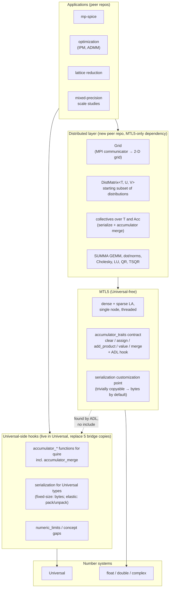

# MTL5 and Elemental: Comparison and Architecture Assessment

**Date**: 2026-10-15
**Companion to**: [elemental-architecture.md](elemental-architecture.md), the survey of Elemental's design and feature set

## The question

Elemental is a distributed-memory (MPI) dense and sparse-direct linear algebra library whose precision is a template parameter. MTL5 is a single-address-space, header-only, type-generic linear algebra library that deliberately does not depend on Universal. The peer repositories (mp-blas, mp-iterative, mp-ir, mp-numerics, mp-ode, mp-spice) compose MTL5 with Universal's number types.

This document answers three questions:
- how the two libraries compare;
- whether there is value in recreating Elemental's features for the MTL5/Universal stack;
- if so, where each piece belongs, given that MTL5 stays Universal-free.

## Short answer

- **Don't recreate Elemental wholesale.** Most of its value is in one idea, the distribution algebra, and a long tail of algorithm variants. The tail is mostly single-node algorithms, and they belong in MTL5 itself, added when a consumer needs them. They don't need Universal.
- **The distribution algebra is where the value is**, but not as a copy. Elemental's precision story is "run the whole computation in type T", over a closed set of types. The MTL5/Universal stack adds something Elemental cannot express: storage in one precision, accumulation in another, including exact quire accumulation.
  - Distributed, that gives **reductions whose result does not depend on the process count or reduction order**: each process accumulates exactly, and the partial quires are combined exactly.
  - We know of no distributed library that offers that for arbitrary number systems.
  - It is a research capability, not a performance one.
- **The layering needs one refinement of the premise.** A distributed layer should sit on **MTL5 alone**, not on MTL5 + Universal. It needs from the element type only:
  - a way to send it, which is a serialization customization point;
  - a way to combine two accumulators, a fifth operation on `accumulator_traits`.

  Universal supplies its side of both contracts as free functions defined next to its own types. MTL5 finds them by argument-dependent lookup (ADL), so neither library includes the other. Today that side exists only as a bridge header copied into five repos; #581 adds the hook that lets it move into Universal. Applications that need Universal (optimization, lattice reduction, mp-spice) sit on top of both.
- **Two prerequisites are worth doing regardless**: replace the duplicated quire bridge with hook functions in Universal, and add an accumulator merge operation to MTL5. Without the merge, MTL5 can't split even one accumulator-typed reduction, such as a dot product, across threads either. #581 adds both the hook and `merge` on the MTL5 side.

## 1. What each library is

| | Elemental | MTL5 |
|---|---|---|
| Scope | Distributed dense LA, one distributed sparse-direct solver (multifrontal LDL), conic optimization, control, lattice reduction | Single-address-space dense and sparse LA, iterative solvers, sparse direct solvers |
| Memory model | MPI, 2-D process grid, 15 data distributions | One address space; persistent thread pool (`MTL5_NUM_THREADS`, default serial), SIMD via Highway or native kernels |
| Language | C++11, SFINAE, compiled library with explicit instantiation | C++20, concepts, header-only |
| Precision | Closed set: `float`, `double`, complex forms, `Quad`, QD's `DoubleDouble`/`QuadDouble`, MPFR `BigFloat`, GMP `BigInt`. Each enabled type is instantiated by macro in `.cpp` files | Open: any type satisfying the `Field`/`Scalar` concepts. Universal's posits, cfloats, LNS, dd/qd, takum and others compile without MTL5 knowing about them |
| Accumulation | In the element type `T` throughout | `accumulator_traits<Acc, Value>`: Value (storage), Acc (accumulation) and Result (delivery) chosen independently; configurations for plain, FMA and super-accumulator (quire) reduction |
| External back ends | MPI, BLAS/LAPACK, optional ScaLAPACK, PMRRR, SuiteSparse, METIS, MPFR/GMP/QD | Optional BLAS/LAPACK dispatch for `float`/`double`; optional UMFPACK, SuperLU, KLU, CHOLMOD, SPQR bindings; none required |
| Size | ~137K lines in `src/`, ~430 headers | ~37K lines in 328 headers |
| Status | **Maintenance mode.** Since March 2026 the commits are CI and build fixes (C++17/20, CMake 4, new compilers) from PETSc and Elemental.jl maintainers; 15 commits from 2018 to 2025. The `llnl/Elemental` fork was last pushed in March 2025 | Active development |

## 2. Feature comparison

"Have" means MTL5 has a native, type-generic implementation. "LAPACK only" means it exists only through the optional LAPACK dispatch, so not for custom types.

### Dense factorizations and solvers

| Elemental | MTL5 | Notes |
|---|---|---|
| Cholesky | Have | |
| Pivoted Cholesky, rank-one up/downdates | **Missing** | Pivoted Cholesky is rank-revealing for semidefinite matrices |
| LU (partial, full pivoting) | Partial pivoting; iterative refinement (`lu_iterative_refine`) | Full/rook pivoting missing. Elemental declares rook but doesn't implement it |
| LDLᵀ, Bunch–Kaufman / bounded BK / Bunch–Parlett | LDLᵀ and Bunch–Kaufman (`ldlt_bk`) | |
| QR, LQ, Householder | Have, with accumulator policy and textbook-reflector option | |
| Column-pivoted QR | **Missing** | The basis for rank-revealing QR, interpolative decomposition and CUR |
| TSQR, CholeskyQR | **Missing** | Mainly valuable distributed; TSQR is a communication-avoiding algorithm |
| RQ, generalized QR/RQ, ID/skeleton | **Missing** | |
| LSE, GLM, Ridge, Tikhonov | **Missing** | Thin wrappers over QR/Cholesky/SVD once those exist |
| Inverse, determinant, inertia, condition, norms | Have (`inv`, `factorization_properties`, `spectral_properties`, `norms`) | |
| Pseudoinverse, matrix sign, square root, Hermitian matrix functions | **Missing** | |
| Sylvester, Lyapunov, Riccati | **Missing** | Elemental builds all three on the matrix sign function |

### Spectral

| Elemental | MTL5 | Notes |
|---|---|---|
| Hermitian EVD: tridiagonal QR | Have (`eigen_symmetric`, with 5.16.0's `dsteqr`-style deflation) | |
| Hermitian EVD: divide and conquer, MRRR | **Missing** | Matters for large n; MTL5's targets so far are small and medium |
| Jacobi EVD | Have (`eigen_symmetric_jacobi`) | The survey lists no Jacobi eigensolver in Elemental; MTL5's is relatively accurate for small eigenvalues |
| Generalized Hermitian-definite EVD | **Missing** | Needs two-sided triangular solves (`TwoSidedTrsm`) |
| Nonsymmetric: Hessenberg + Francis double shift | Have (`eigenvalue`, `eigen`) | |
| Multishift, aggressive early deflation | **Missing** | |
| SVD | One-sided Jacobi (full, thin, V-only), `null_vector`; `gesdd` with LAPACK | Golub–Reinsch / bidiagonal D&C only through LAPACK. Jacobi is accurate but O(n³) per sweep; a bidiagonal path matters for large matrices |
| Polar decomposition (QDWH) | **Missing** | |
| Pseudospectra | **Missing** | |
| Lanczos, Arnoldi, power iteration | Have (`itl/eigen`), plus sparse shift-invert | |

### Sparse

MTL5 is **ahead** of Elemental here. Elemental has one distributed multifrontal LDL, built to serve its interior-point solvers. MTL5 has:
- sparse LU, Cholesky, LDLᵀ and QR;
- supernodal LU and LDLᵀ;
- a native KLU;
- AMD, COLAMD, RCM, minimum-degree and Dulmage–Mendelsohn orderings;
- level-scheduled parallel triangular solves;
- an accumulator policy through factorization and solve (#535);
- iterative refinement;
- ten Krylov methods, eight preconditioners, three smoothers and multigrid.

What it lacks: **nested dissection** (needed for any distributed sparse factorization), a **multifrontal** factorization, and anything distributed.

### Beyond linear algebra

| Elemental | MTL5 | Where it would belong |
|---|---|---|
| LP/QP/SOCP interior-point methods, ADMM, models, proximal operators | None | An application repo above MTL5; it needs regularized quasi-definite LDL from MTL5 |
| Lattice reduction (LLL, BKZ), number theory | None | Above MTL5 + Universal: it depends on extended-precision and integer types (`ereal`, `efloat`, `einteger`, `erational`) |
| Control (Sylvester, Lyapunov, Riccati) | None | MTL5, once the matrix sign function exists. These are general dense linear algebra |
| ~80 test-matrix generators | About 22 generators (`generators/`) | MTL5. Add specific ones as tests need them |

## 3. The precision models, side by side

This is where the two designs differ most, and it decides the value question.

**Elemental** makes precision a template parameter and instantiates a fixed list. Its BLAS/LAPACK wrappers include reference implementations for the non-native types, so the same distributed LU runs in `double`, `DoubleDouble` or `BigFloat`. Everything, accumulation included, happens in that one type. Adding a new number system means editing Elemental's instantiation macros and back-end wrappers.

**MTL5 + Universal** separates three things Elemental fuses:
1. **The algorithm is type-generic by concept**, not by instantiation list. A posit, takum, LNS or cfloat factorization compiles if the type behaves like a field.
2. **Accumulation is a policy.** `accumulator_traits<Acc, Value>` lets a kernel store in one precision and accumulate in another. Configurations:
   - plain wider accumulation;
   - FMA;
   - a super-accumulator such as Universal's quire. Today it plugs in through a bridge header copied into the peer repos. After #581 it plugs in through hook functions Universal defines itself.

   Since 5.17.0 this covers the sparse direct solve phase too.
3. **The number types live in Universal**, and the coupling lives in peer repos.

Universal covers Elemental's types and more:

| Elemental | Universal |
|---|---|
| `DoubleDouble`, `QuadDouble` (QD) | `dd`, `qd`, plus `dd_cascade`, `td_cascade`, `qd_cascade` |
| `BigFloat` (MPFR) | `efloat` (elastic multi-digit), `ereal` (elastic multi-component) |
| `BigInt` (GMP) | `einteger`; `erational` for exact rationals |
| `Quad` (`__float128`) | `cfloat<128,15>` and friends |
| none | posit, takum, LNS, cfloat, fixpnt, bfloat16, microfloat/MX formats, interval, **quire** |

So recreating Elemental's arbitrary-precision capability adds nothing on its own. The stack already has it on a single node. The open question is distribution.

## 4. Is there value in a distributed layer?

The case **for**:
- **Exact distributed reductions.** Elemental's distributed dot products, norms and GEMM reduce partial sums with MPI collectives in type `T`. The result then depends on how the data is partitioned and the order of the reduction. A quire's sum is exact and order-independent, so if each process accumulates its partial sum into a quire and the quires are combined exactly, one rounding at the end gives the **same bits on 1 or 1,000 processes**. Bitwise reproducibility across process counts is a known HPC problem (ReproBLAS and similar libraries address it for IEEE floating point). We know of no library that offers it for arbitrary number systems.
- **Software-emulated arithmetic changes the compute/communication balance.** A posit or `dd` operation costs many hardware instructions, so the work per byte moved rises. Distribution pays off at smaller problem sizes than it does for `double`. Large mixed-precision studies may simply need more nodes to finish.
- **A coherent home for scale experiments.** mp-spice's circuit matrices, or a mixed-precision solver study at 10⁶+ unknowns, will at some point need more memory than one node has.

The case **against**, or at least for caution:
- **Size.** Elemental is about 137K lines of `src/`, and the distribution algebra is the hard part. Even a minimal useful subset is a substantial, multi-month programme, with a different testing discipline (multi-process CI and MPI implementations across platforms). MTL5's CI covers 8 single-node platforms today.
- **No current consumer.** No peer repo has run out of memory or time on one node yet. The reproducibility capability is compelling but speculative until an experiment needs it.
- **Quires are large.** A posit32 quire is 512 bits, 8× a `double`. A Kulisch accumulator for binary64 is about 4,300 bits, roughly 70× a `double`. Bulk data moves in the element type and isn't affected, but every reduction moves accumulators, so the exact-reduction collectives move that many more bytes than a `double` allreduce. For latency-bound reductions that matters little; for reduction-heavy algorithms it matters a lot.
- **The alternative of using Elemental itself.** Elemental is BSD-licensed and templated, and could in principle be given posit or dd instantiations. But it has no accumulator seam. Accumulation in `T` is built into every kernel and collective, which is exactly the capability that would make the effort worthwhile. And it is in maintenance mode. Extending it would mean maintaining a fork of a C++11 codebase with none of MTL5's concepts or policy design.

**Verdict:** a distributed layer has real, distinctive value, but only for the exact-reduction capability, which Elemental can't provide. That is a reason to build a small one aimed at that capability when an experiment calls for it, not to port Elemental. Dense algorithm variants are a separate decision and belong in MTL5.

## 5. Proposed architecture

### Where each piece goes, and why

**MTL5 (layer 1) keeps everything that is single-node and type-generic.** That includes the missing dense algorithm variants:
- column-pivoted QR;
- pivoted Cholesky;
- polar decomposition and the matrix sign function, and Sylvester/Lyapunov built on them;
- generalized symmetric-definite eigenproblems;
- a bidiagonal SVD for large matrices;
- nested dissection.

None of these needs Universal or MPI, and every consumer benefits. MTL5 also gains **two small contracts** that the layers above need:
1. **`accumulator_traits::merge(Acc& a, const Acc& b)`**, combining two accumulators.
   - Plain and FMA configurations: `a += b`.
   - A quire: exact quire addition.

   #581 adds `merge` to the contract. Using it in the thread pool is still to do.

   MTL5 needs this for itself. Today `thread_pool::parallel_reduce` combines per-thread partials with `+` on the value type, so no single accumulator-typed reduction (one dot product, one norm) can be split across threads. Kernels that parallelize do so by giving each output element its own accumulator, as GEMM does over rows. With a merge, an exactly accumulated reduction can run on several threads and give the same bits as on one.
2. **An element serialization customization point.** It defaults to bytes for trivially copyable types, so MTL5 itself never needs to know about MPI. It is needed only once something moves values between address spaces. It should use the same ADL pattern as the accumulator hook, so Universal can serialize its elastic types without including MTL5.

**Universal's side of those contracts** covers three things:
- the quire's accumulator operations, including merge;
- serializers for elastic types;
- concept and `numeric_limits` fixes.

The accumulator part already exists as `quire_accumulator.hpp`. It is copied **byte-for-byte into mp-blas, mp-ir, mp-iterative and mp-numerics**, with a **diverged** variant in mp-spice. It specializes MTL5's trait, so it has to include MTL5, which is why it can't live in Universal as written.

#581 removes that constraint. MTL5's `accumulator_traits` now forwards to hook functions found by argument-dependent lookup on the accumulator type:
- `accumulator_clear`
- `accumulator_assign`
- `accumulator_add_product`
- `accumulator_value`
- `accumulator_merge`, optional

Universal can define these once next to `quire`, generically over every type that has a quire, without including MTL5. MTL5 only names them. The pattern is the one `fma_accumulator` already relies on for a posit's own `fma`.

An explicit specialization still wins over the hook. So the copies keep working until each repo deletes its own, and no separate bridge repository is needed. That is worth doing now, independent of any distributed work.

**The distributed layer (layer 2) depends on MTL5 only**, not on Universal. That refines the "on top of MTL5/Universal" premise. The reason is the same one that keeps MTL5 Universal-free:
- it stays testable and usable with `double` alone;
- its correctness doesn't depend on a number-system library;
- Universal's types reach it through the same two contracts every other type uses.

An application that wants distributed posits depends on layer 2 and Universal. The distributed layer itself doesn't.

**Applications (layer 3)** that need Universal, such as optimization, lattice reduction and circuit simulation, live in peer repos on top of both. That is how mp-spice and the other mp-* repos already work.

### A minimal distributed layer

If and when an experiment needs one, start much smaller than Elemental:

1. **`Grid`** over an MPI communicator.
2. **`DistMatrix<T,U,V>`** with five distributions: `[MC,MR]`, `[MC,STAR]`, `[STAR,MR]`, `[STAR,STAR]` and `[CIRC,CIRC]`. That is enough for SUMMA GEMM, panel factorizations, and gathering to a root as Elemental's AED does. Element-cyclic only; block-cyclic and ScaLAPACK compatibility come later, if at all.
3. **Redistribution as assignment** between those five, as in Elemental: the conversions run the collectives.
4. **Collectives over both `T` and `Acc`**: an allreduce that merges accumulators and rounds once.
5. **Algorithms:** distributed dot and norms (the reproducibility demonstration), SUMMA GEMM (stationary-C), Cholesky, LU with partial pivoting, Householder QR, TSQR. Each algorithm's local kernels are MTL5's.

**Success criterion:** a distributed exact dot product and GEMM whose results are bit-identical across 1, 2, 4 and 8 processes for posit and `dd`, with the cost of the quire collectives measured against a `double` allreduce. If that holds and an experiment needs it, extend. If no experiment needs it, stop there.

## 6. Recommendations

| Priority | Action | Where |
|---|---|---|
| Now | ADL hook and `merge` in `accumulator_traits` (#581) | MTL5 |
| Now | Define the hook functions for `quire` | Universal |
| Then | Delete `quire_accumulator.hpp` from the mp-* repos; reconcile mp-spice's diverged `quire_acc` wrapper first | mp-* repos |
| Next | Use `merge` to let accumulator-typed reductions run on the thread pool | MTL5 |
| As consumers need them | Column-pivoted QR; pivoted Cholesky; polar/sign; Sylvester/Lyapunov; generalized symmetric-definite EVD; bidiagonal SVD; nested dissection | MTL5 |
| When an experiment needs scale or reproducibility | Minimal distributed layer as in §5, measured against the success criterion | New peer repo, MTL5-only dependency |
| Not planned | Optimization, lattice reduction, control applications | Application peer repos, if ever |
| Not recommended | Porting Elemental wholesale, or extending Elemental with Universal types | |

## Open questions

- **Is bitwise reproducibility across process counts a goal for the mixed-precision research programme?** If yes, the distributed layer has a clear purpose and the success criterion above is the first milestone. If not, the case for distribution rests on problem size alone, and no consumer has hit that limit.
- **Which consumer drives the dense variants?** Column-pivoted QR is the most broadly useful: rank-revealing, and the basis of ID and CUR. mp-spice and the null-space work may have more specific needs.
