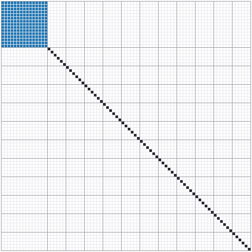
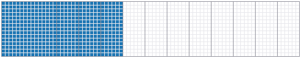
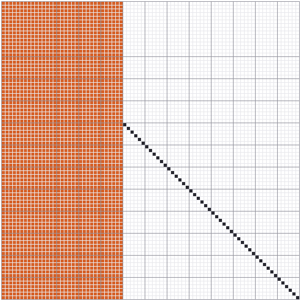
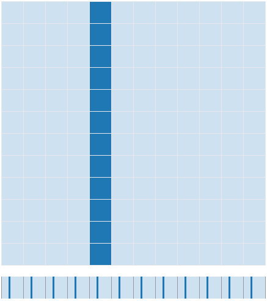
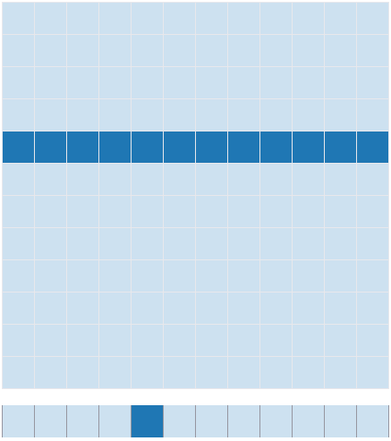

# Loop order and sparsity in mtl::mult: the i-k-j GEMM and the CRS × dense product

PR #552 makes two changes to `mtl::mult` that leave the arithmetic untouched and change only the order it is done in:

- **#549:** the generic dense kernel runs as an i-k-j loop when B and C are row-major. **1.8× faster** on the 81×81 filter products at baseline x86-64, **2.65×** with AVX2. Larger matrices gain up to 3.3× and 7×.
- **#550:** `mult(compressed2D, dense2D, dense2D)` walks A's stored entries instead of looking each `A(r, k)` up. On the filter's transition matrix it goes from **635 µs to 3.6 µs**, which is **3.8× faster than the column-by-column matvec** that was the only usable sparse route before.

This page:

1. describes the problem and the operands that exposed it;
2. uses their non-zero structure to show where the opportunity is;
3. explains each algorithm and why the loop restructuring works;
4. reports measurements on an i7-12700K.

It also records one qualification to the PR's "bit-identical" claim: it depends on FP contraction, as the [Bit-identity and FP contraction](#bit-identity-and-fp-contraction) section explains.

## The problem

The work came from porting a visual-inertial filter's covariance algebra to MTL5 (branes-ai/cortex #448). The port reproduced the hand-written products bit for bit, but every frame got slower: +7 % p50 and +17 % p99 latency. All of the slowdown was inside `mtl::mult`. The filter's error state has 81 dimensions: a 15-dimensional IMU block followed by 11 six-dimensional clone poses. A frame's products are:

| product | shapes | left operand |
|---|---|---|
| P·P, F P Fᵀ | 81×81 · 81×81 | dense, or the transition F |
| P·Hᵀ | 81×81 · 81×15 | dense |
| K·H | 81×15 · 15×81 | dense |
| F·P | 81×81 · 81×81 | F = Φ ⊕ I, mostly zero |
| (I − KH)·P | 81×81 · 81×81 | Joseph factor, partly zero |

Two separate costs were in that slowdown.

1. **Dense products ran 1.5–2.6× slower than the hand loop.** Without BLAS or `MTL5_NATIVE_FAST_GEMM`, a `dense2D<double>` product reaches `detail::mult_generic_rows`. That function was an i-j-k dot product. The cortex code it replaced was an i-k-j loop. Both do the same arithmetic in the same order, but only one of them vectorizes (see [Why the loop order matters](#why-the-loop-order-matters)).
2. **Sparse left operands had no matrix kernel.** MTL5 had CRS × vector (`mult_sparse_crs`) and CRS × CRS (`spgemm`), but no CRS × dense matrix. `mult(compressed2D, dense2D, dense2D)` fell to the generic kernel, which reads `A(r, k)` for every (r, c, k). For `compressed2D`, `A(r, k)` is a `std::lower_bound` over row r's column indices. So the product paid for a binary search on every one of its 81³ = 531,441 terms, including the ones that are zero. The workaround was one sparse matvec per column of B.

## The opportunity: the operands' non-zero structure

The figures below show the filter's left operands at their real dimensions. Each square is one matrix entry. The grid lines mark the IMU block (the first 15 rows and columns) and the eleven 6-wide clone blocks.

**The transition F = Φ ⊕ I.** The IMU block Φ is dense (blue). Clones don't move during propagation, so the rest of F is the identity (black).



F has **291 non-zeros out of 6,561 entries (4.4 %)**. A dense product F·P does 531,441 multiply-adds, and 95.6 % of them multiply by zero. A product that touches only stored entries does 291 × 81 = 23,571.

**The measurement Jacobian H.** It is dense in the IMU columns and in the columns of the clones that observed the feature track; here that is three clones.



**The Joseph factor I − KH.** K is 81×15 and dense, so K H is non-zero in exactly H's non-zero columns (orange). Every other column is the identity's.



The structure depends on how many clones observed the track. With c clones observing, 15 + 6c columns are dense:

| clones observing | non-zeros of I − KH | fraction of entries | multiply-adds skipped by a sparse product |
|---|---|---|---|
| 1 | 1,761 | 27 % | 73 % |
| 3 | 2,721 | 41 % | 59 % |
| 6 | 4,161 | 63 % | 37 % |
| 11 (all) | 6,561 | 100 % | 0 % |

So F has the most to gain. The Joseph factor gains less, by an amount that depends on the track. When all 11 clones observe it, the factor is fully dense, and a sparse kernel should then cost about the same as the dense one. The measurements below check that.

## Why the loop order matters

The generic kernel computes C = A·B with each C(r, c) built as `0 + A(r,0)·B(0,c) + A(r,1)·B(1,c) + …` in ascending k. There are two ways to nest the loops that produce exactly that sequence of operations for every element.

**i-j-k (before #549).** For each output element, run k as a dot product:

```cpp
for r:                       // rows of C
  for c:                     // columns of C
    acc = 0
    for k: acc = acc + A(r,k) * B(k,c)     // walks B down column c
    C(r,c) = acc
```

**i-k-j (after #549).** Keep a whole row of C as the accumulator and add one scaled row of B into it per k:

```cpp
for r:
  C.row(r) = 0
  for k:
    a = A(r,k)
    for c: C(r,c) = C(r,c) + a * B(k,c)    // walks B along row k
```

Each C(r, c) still receives `+ A(r,k)·B(k,c)` for k = 0, 1, 2, … in that order. The only difference is that its additions are interleaved with those of the other elements in its row. Each element's own sequence of roundings is unchanged. That argument underlies the PR's bit-identity claim, and the limits on it are covered in [Bit-identity and FP contraction](#bit-identity-and-fp-contraction).

What changes is the inner loop the compiler sees. The figures show one inner loop's reads from a 12×12 row-major B. The grid is the matrix, and the strip under it is the same 144 elements in address order, 12 per row.

i-j-k reads **one column** of B. In memory that means one element every `ncols × 8` bytes, which for an 81-wide B is one element per 648 bytes:



i-k-j reads **one row** of B, a contiguous run:



Two properties of the inner loop decide whether it vectorizes, and the reorder flips both of them:

1. **Dependence.** i-j-k's inner loop is a reduction: every iteration adds into the same `acc`. Without `-ffast-math`, the compiler may not reassociate floating-point additions, so the sum has to be accumulated in order. i-k-j's inner loop updates a different `C(r, c)` on every iteration, so the iterations are independent and the compiler can process 2 (SSE2) or 4 (AVX2) of them in one instruction.
2. **Access pattern.** The strided column walk turns each vector load into lane-by-lane gathers. It also uses one double out of every 64-byte cache line it brings in, which is why the gap widens once B no longer fits in L1. The row walk uses whole cache lines and plain vector loads.

GCC 15's vectorizer report (`-fopt-info-vec`) on the benchmark confirms this. Before, the only loop it reports for the kernel is the k loop, vectorized as an in-order reduction: the products are formed in vector registers, but the additions still run one after another. After, both i-k-j inner loops (dense and CRS) are reported as "loop vectorized using 16 byte vectors". Each is versioned with a runtime alias check, which falls back to scalar code only if C's row overlaps B's row.

The i-k-j branch is taken only when B and C are both row-major with contiguous rows (`detail::row_major_contiguous_v`) and no custom accumulator is set. Other layouts, such as a `transposed_view` operand, keep the i-j-k loop. So does the custom-`Accumulator` path, which has to drive `accumulator_traits` one element at a time.

## The CRS × dense algorithm

With A in CRS form, the i-k-j form loses its last bit of waste: k doesn't have to run over all of A's columns, only over the ones row r actually stores.

```cpp
for r:
  C.row(r) = 0
  for each stored (k, v) in A.row(r), ascending k:   // starts[r] .. starts[r+1]
    for c: C(r,c) = C(r,c) + v * B(k,c)
```

This is `detail::mult_sparse_crs_dense_rows`. Three properties follow from its shape:

- **Cost.** The work is nnz(A) × ncols(B) multiply-adds. That is 23,571 for F·P, against 531,441 for the dense product. Before, it was 531,441 multiply-adds plus a binary search for each one. Each stored entry of A is read exactly once, sequentially from the CRS arrays.
- **Same result as the dense product.** C(r, c) receives the same terms as in the dense i-k-j loop, in the same ascending-k order, minus the terms where A(r, k) is not stored. If those omitted terms are exact zeros, i.e. `0 · B(k,c)` with finite B, then adding them would not have changed the sum. So the result equals the dense product bit for bit (with the contraction caveat below). The test checks this, and also checks agreement with the column-by-column sparse matvec.
- **Threading.** `mult_sparse_crs_dense_par` splits the output rows into bands, like `mult_sparse_crs_par`. Each row is written by exactly one band, so the result doesn't depend on the thread count.

## Measurements

### Method

- **Machine:** Intel Core i7-12700K (Alder Lake). Pinned to logical CPU 4, a P-core, with `taskset`. `powersave` governor, turbo enabled.
- **Compiler:** GCC 15.2, `-std=c++20 -O3 -DNDEBUG`. "Baseline" means no `-march`, i.e. x86-64 with SSE2. "AVX2" means `-march=native`. No BLAS and no `MTL5_NATIVE_FAST_GEMM`: the configuration where the generic kernel runs, which is the one #552 changes.
- **Threads:** `MTL5_NUM_THREADS=1`, so each number measures the kernel and not the pool.
- **A/B:** one source, `benchmarks/bench_mult_ikj.cpp`, compiled twice: against `main` at the merge base, and against the PR branch. `mtl::mult` is the only arm whose code differs between the two binaries.
- **Rounds:** the two binaries run alternately, 6 rounds each. Each number is the mean time per product within a round of at least 2 ms, taking the minimum over 21 rounds per process and over the 6 processes.
- **Values:** random doubles, with the structure from the figures above.

**Controls.** Two hand-written loops on raw pointers are compiled into both binaries:

- `hand_ijk`, the i-j-k loop;
- `hand_ikj`, an i-k-j loop that skips zero `A(r, k)`, like the one cortex used before the port.

Because their code is identical in both binaries, they show how much of a before/after difference is noise. At baseline, every control agrees between the two binaries to within 1 %, and the AVX2 controls agree to within 3 %. One effect does not show up in the minimums: some processes ran the vectorized i-k-j loops roughly 20 % slower for their whole lifetime, in either binary. In a test that isolated it, it hit 1 of 12 runs of the same binary, and it did not depend on where the buffers were placed. It shows up in the medians, not in the minimum over processes.

### Dense products (#549)

µs per product, single-threaded.

| product | before (i-j-k) | after (i-k-j) | speed-up | hand i-k-j loop | before, AVX2 | after, AVX2 | speed-up, AVX2 |
|---|---|---|---|---|---|---|---|
| P·P, 81×81 | 137.4 | 76.0 | **1.81×** | 73.2 | 141.4 | 53.4 | **2.65×** |
| P·Hᵀ, 81×81 · 81×15 | 25.6 | 16.4 | **1.56×** | 16.4 | 26.0 | 15.7 | **1.65×** |
| K·H, 81×15 · 15×81 | 23.9 | 13.0 | **1.84×** | 13.2 | 25.9 | 8.4 | **3.08×** |

After the change, `mtl::mult` runs within 4 % of the hand-written loop it replaced. Before, it was 1.6–1.9× slower than that loop. That gap was the filter's dense-product regression.

**Size sweep, square n×n.** The gain grows with size, for the two reasons in the previous section: wider vectors, and B's column walk falling out of cache.

| n | before | after | speed-up | before, AVX2 | after, AVX2 | speed-up, AVX2 |
|---|---|---|---|---|---|---|
| 8 | 0.14 | 0.13 | 1.07× | 0.16 | 0.09 | 1.68× |
| 16 | 1.07 | 0.75 | 1.41× | 1.11 | 0.56 | 1.99× |
| 32 | 8.05 | 4.55 | 1.77× | 8.16 | 2.61 | 3.13× |
| 64 | 67.0 | 33.9 | 1.98× | 67.8 | 16.6 | 4.09× |
| 128 | 900 | 276 | 3.27× | 903 | 129 | 7.02× |
| 256 | 7,488 | 2,447 | 3.06× | 7,493 | 1,091 | 6.87× |

**Before** barely changes with the instruction set (137 → 141 µs at 81×81), because its additions run in order whatever the vector width. **After** gains a factor of 1.3–2.2 from AVX2 at n ≥ 16. At baseline the speed-up rises toward 2× by n = 64, the number of doubles in an SSE2 register. At n = 128 the 128 KB B no longer fits in the 48 KB L1, and the column walk's cache misses push the gap past the vector width. (These are dense products without BLAS; with `MTL5_WITH_BLAS` or `MTL5_NATIVE_FAST_GEMM`, a `dense2D<double>` product doesn't reach this kernel at all.)

### Sparse left operands (#550)

µs per product, single-threaded, baseline x86-64. P is a dense 81×81 matrix.

| left operand | nnz | `mtl::mult` CRS, before | `mtl::mult` CRS, after | speed-up | column-by-column matvec | dense i-k-j, same matrix | hand loop, skips zeros |
|---|---|---|---|---|---|---|---|
| F = Φ ⊕ I | 291 | 635 | **3.6** | 177× | 13.7 | 74.3 | 6.4 |
| I − KH, 1 clone | 1,761 | 1,335 | **18.6** | 72× | 47.2 | 74.5 | 21.8 |
| I − KH, 3 clones | 2,721 | 1,574 | **28.2** | 56× | 67.1 | 74.5 | 31.1 |
| I − KH, 6 clones | 4,161 | 1,805 | **42.8** | 42× | 110.3 | 74.7 | 45.2 |
| I − KH, 11 clones | 6,561 | 2,223 | **74.2** | 30× | 167.3 | 75.0 | 74.1 |

With AVX2 the CRS product takes 2.8, 12.3, 18.7, 28.1 and 55.4 µs on the same five operands. That is 4.9× faster than the column-by-column route on F, and 3.6× faster with all 11 clones.

What the table shows:

- **Before, the product was unusable.** 635 µs for F·P is 8.6× slower than multiplying the dense matrix: a binary search per term costs more than the term. That is why the port used the column-by-column matvec instead.
- **After, time is proportional to nnz.** It goes from 3.6 µs at 291 non-zeros to 74 µs at 6,561, roughly 0.13–0.15 ns per stored entry per output column.
- **No penalty for a dense matrix.** With all 11 clones observing, I − KH is fully dense, and the CRS product takes 74.2 µs against the dense i-k-j's 75.0. Storing a dense matrix as CRS costs nothing in the product.
- **It beats the hand-written zero-skipping loop.** 3.6 vs 6.4 µs on F, because the hand loop still reads and tests all 81 entries of each A row, while the CRS loop only visits the stored ones.
- **It beats the column-by-column matvec by 2.3–3.8×.** The matvec route repeats the CRS traversal once per column of B and copies each column in and out of a vector.

**What is left: building the CRS operand.** Building the `compressed2D` with `mat::inserter` from a dense 81×81 matrix takes 13.1 µs for F and 130 µs for I − KH (3 clones), on every call. For F that is 3.7× the product it enables. `compressed2D` copies the arrays it is given, so a caller that builds its operator every frame pays that each time. The kernel pays off when the CRS operand is built once and reused, or built directly from known structure. A non-owning CRS view over caller-owned arrays would remove the copy; it is not part of #552.

## Bit-identity and FP contraction

The PR states that both kernels are **bit-identical** to the dense i-j-k loop, and `tests/unit/operation/test_mult_ikj.cpp` checks this bit for bit. The argument, that each element's sequence of roundings is unchanged, holds at the source level. But it rests on one assumption: that `acc + a * b` is rounded twice in every loop, once for the multiply and once for the add.

FP contraction breaks that assumption. When the ISA has FMA, the compiler may fuse `acc + a * b` into a single FMA with one rounding, and it decides this **per loop**. GCC's default is `-ffp-contract=fast`, and Clang's is `on`, which still fuses within an expression. A small program compiled both ways compared `mtl::mult` against two references: one with every term unfused, and one with every term fused through `std::fma`.

| kernel | baseline x86-64 (no FMA) | `-march=native` | `-march=native -ffp-contract=off` |
|---|---|---|---|
| i-j-k (before) | = unfused | **= neither** | = unfused |
| i-k-j (after) | = unfused | = fused | = unfused |

Under contraction, the new kernel fuses every term consistently. The old one fused some of its terms and not others: that is consistent with its reduction being split between a vectorized body and a scalar remainder, which the compiler contracts differently. So the old kernel was the less predictable of the two. But the two no longer agree bit for bit, and the PR's test detects it.

- **CI caught it.** The first push of #552 failed `op_test_mult_ikj` on two lanes: `Linux x64 FP-contract (x86-64-v3)`, which builds the suite with AVX2+FMA, and `Linux ARM64 (Clang 18)`, where FMA is part of the base ISA. The failures were its two i-j-k comparisons. The same test failed locally under `-march=native`.
- **The same situation has come up before.** The threaded solve tests (#381) assert bit-identity against their serial counterparts. `tests/unit/CMakeLists.txt` compiles them with `-ffp-contract=off` and explains why: contraction changes nothing about summation order, but a compiler may contract one loop nest and not the other. `op_test_mult_ikj` makes the same kind of claim, so it now gets the same flag.
- **What to tell users.** "Bit-identical" here means bit-identical when the compiler does not contract: with `-ffp-contract=off`, or on a target without FMA (baseline x86-64). That covers every check in the [Measurements](#measurements) section; all of them came out equal at baseline. Under contraction, results match the old kernel to rounding, not to the bit.

The same first push also failed both `LAPACK` lanes, with a compile error rather than a numerical one. In `mult()`, the new CRS branch returns from inside an `if constexpr` that has no `else`, so the BLAS gate after it was still instantiated for a `compressed2D` or `transposed_view` operand. That gate tested `BlasDenseMatrix<M> && … && is_row_major_v<MA> == is_row_major_v<MC>`. A conjunction in a constant expression instantiates every operand it names, even after a false one. `is_row_major_v<M>` requires `M::orientation`, which neither type has. The `transposed_view` case was already possible before #552; the PR's test was the first to reach it in a BLAS build. The gate is now two nested `if constexpr` statements, so the orientation test is only instantiated for operands already known to be dense. With the build fixed, one check in the test turned out to assume that `mult()` on `dense2D<double>` reaches the generic kernel. With BLAS enabled it reaches `?gemm`, which sums in its own order, so that check now runs only when neither BLAS nor `MTL5_NATIVE_FAST_GEMM` is enabled.

## Reproducing

```bash
# headers before and after
git worktree add ../mtl5-before <merge-base>
g++ -std=c++20 -O3 -DNDEBUG -I../mtl5-before/include benchmarks/bench_mult_ikj.cpp -o bench_before -pthread
g++ -std=c++20 -O3 -DNDEBUG -Iinclude              benchmarks/bench_mult_ikj.cpp -o bench_after  -pthread

# interleaved, pinned, single-threaded
for round in 1 2 3 4 5 6; do
  for v in before after; do
    MTL5_NUM_THREADS=1 taskset -c 4 ./bench_$v > run_${v}_$round.csv
  done
done

# figures
g++ -std=c++20 -O2 -Iinclude benchmarks/fig_mult_ikj.cpp -o fig_mult_ikj && ./fig_mult_ikj docs/img
```

Each run prints `case,arm,nnz,us` lines, plus `#check` lines:

- `crs_equals_dense` and `crs_equals_columns`: whether the CRS product matched the dense product and the column-by-column matvec bit for bit.
- `mtl_mult_sum`: a checksum of `mtl::mult`'s result, which should be the same in both builds.

At baseline, all of them were equal across all 12 runs. For the AVX2 numbers, add `-march=native`: the timings are as reported above, and the `#check` lines then show the contraction differences described in the previous section.
